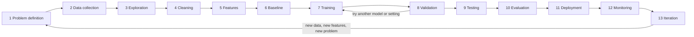

# Day 3: The AI/ML Lifecycle

*100 Days of AI Engineering, Module 1: AI Foundations*

**Time:** about 2 to 3 hours
**You will build:** a filled-in project brief for a delivery case and one for a case of your own. You will also run an optional leakage check that produces an 87% accurate model from pure noise, then shows why the result is fake.
**You should know:** Day 2 (features, labels, loss, generalization, train vs test) and basic Python for the optional check.
**You will install:** nothing for most of the day. The optional check in section 7 needs Python 3.11 or newer, `numpy==2.2.6`, `scikit-learn==1.6.1` and `scipy==1.15.2`.

---

## 1. The big idea

On Day 2 you wrote a full training loop in about ten lines. In a real job those ten lines are the smallest part of the work. Before them, someone has to decide what problem is worth solving, find and clean the data, and decide what "good" means. After them, someone has to prove the model works on data it has never seen, ship it, watch it in production and fix it when the world changes. That whole path is the **ML lifecycle**.

Many failed AI projects have a sound algorithm and still fail, because a stage was skipped. Common examples are no baseline, a test set that leaked into training, and no monitoring after launch. Today you learn the stages, what each one produces, and how each one breaks. This is the map for every project in the remaining 97 days.

---

## 2. A short history

| Period | What happened | Why it matters today |
|---|---|---|
| 1996 | Fayyad, Piatetsky-Shapiro and Smyth describe the "knowledge discovery in databases" (KDD) process: selection, preprocessing, transformation, data mining, interpretation. | First widely cited step-by-step process for learning from data. |
| Late 1990s | A group of companies publishes [CRISP-DM](https://en.wikipedia.org/wiki/Cross-industry_standard_process_for_data_mining): business understanding, data understanding, data preparation, modeling, evaluation, deployment, drawn as a loop. | Still a widely used process model in data science teams. Its key idea: you go round more than once. |
| 2015 | Google engineers publish "Hidden Technical Debt in Machine Learning Systems" (Sculley et al., NeurIPS). Its famous figure shows the ML code as a small box surrounded by data collection, feature extraction, serving and monitoring. | The clearest statement that the model is the small part. |
| Around 2018 onward | [MLOps](https://en.wikipedia.org/wiki/MLOps) emerges as a discipline: version data and models, automate training and deployment, monitor in production. | The lifecycle becomes software engineering. Module 10 covers it. |
| 2023 onward | LLM applications add new stages: prompt and retrieval design, evaluation sets for generated text, and guardrails. | The same lifecycle, with different tools (Modules 8 and 9). |

---

## 3. The lifecycle in one picture



If Mermaid does not render where you read this, here is the same loop in text:

```
problem → data → explore → clean → features → baseline → train ⇄ validate
   ▲                                                              │
   │                                                              ▼
iterate ◄── monitor ◄── deploy ◄── evaluate ◄────────────── test (once)
```

Two loops matter. The small loop between training and validation runs dozens of times in a week. The big loop from monitoring back to problem definition runs over months, and it holds most of the long-term work.

**Reference image to find:** search "CRISP-DM diagram" and "Hidden Technical Debt in Machine Learning Systems figure 1". Put them side by side. The first shows the stages. The second shows how little of the system is the model.

---

## 4. The 13 stages, with one running case

We follow one case through every stage. **The case:** a food delivery company wants to reduce the number of customers who get a late order without warning. The product manager asks, "Can we use AI for late deliveries?"

### 4.1 Problem definition

**Intuition.** A builder asks what a house is for before pouring the foundation. A family home and a warehouse need different ones.

**Definition.** A written statement of the decision the model supports, the exact prediction (input, output, and when it is made), the metric, the minimum acceptable performance, and what happens when the model is wrong.

**Worked example.** "Can we use AI for late deliveries?" becomes: *At the moment an order is placed, predict whether it will arrive more than 15 minutes after the promised time. If yes, show a revised time to the customer. Success: at least 70% of truly late orders are flagged (recall), and no more than 1 in 3 flags is a false alarm (precision of at least 0.67). A false alarm costs a slightly worse customer impression. A missed late order costs a support ticket.*

**Common mistakes.** Starting with a model instead of a decision. Choosing a metric nobody in the business cares about. Leaving out "when is the prediction made," which leads straight to leakage (section 5).

### 4.2 Data collection

**Intuition.** You cannot cook a dish if the ingredients are not in the kitchen.

**Definition.** Finding, gathering or creating the examples and labels the model needs, and checking that you are allowed to use them.

**Worked example.** For late deliveries: past orders (restaurant, time of day, distance, items), courier data, weather, and the label (actual arrival minus promised time, where more than 15 minutes means late). Six months of orders gives about 2 million rows.

**Common mistakes.** Collecting data that does not cover the conditions you will face, such as six months of summer data for a winter launch. Ignoring privacy law: customer addresses are personal data under rules such as the EU's GDPR. Your Day 2 "and" problem was also a collection failure. Thirty hand-written rows did not cover enough ways of complaining.

### 4.3 Exploration

**Intuition.** Walk around a used car before you buy it.

**Definition.** Exploratory data analysis (EDA) means counting rows, checking label balance, and looking at distributions, missing values and relationships before any modeling.

**Worked example.** You find that 8% of orders are late. Late orders cluster on Friday evenings. You also find 3,000 orders with a negative delivery time, which is impossible.

**Common mistakes.** Skipping EDA because the deadline is close. The 8% balance means a model that predicts "never late" is already 92% accurate, so you need that number before you celebrate a 93% model. EDA notebooks are a standard part of data science interviews and take-home tests (Day 20).

### 4.4 Cleaning

**Intuition.** Washing and peeling vegetables before cooking.

**Definition.** Fixing or removing data that is wrong, missing, duplicated or inconsistent, and recording every decision you make.

**Worked example.** The 3,000 negative delivery times came from a timezone bug in one region. You fix the timezone instead of deleting the rows, because deleting them would remove an entire region from the data. You log the fix in a cleaning notes file.

**Common mistakes.** Silently dropping rows with missing values, which can remove a whole group of customers. Filling gaps with a statistic computed on all rows before splitting, which is a small leak (section 5). Data teams often say most project time goes into cleaning and preparing data. Day 19 covers it.

### 4.5 Features

**Intuition.** Choosing which facts to tell a friend so they can guess how late your pizza will be: distance, rain, how busy the restaurant is.

**Definition.** Turning cleaned data into model inputs that are available **at the moment the prediction is made**.

**Worked example.** Good features: distance in km, hour of day, day of week, the restaurant's average prep time last week, rain yes or no. A tempting bad feature is "courier pickup delay." It predicts lateness very well, but it only exists after the order is placed and the courier arrives. At prediction time it does not exist yet. That is leakage by time.

**Common mistakes.** Any feature computed with information from after the prediction moment. Any feature that is a disguised copy of the label. Feature stores such as Feast exist so that training and production compute features the same way.

### 4.6 Baseline

**Intuition.** Before buying an expensive fitness tracker, count your steps with a cheap pedometer. If the expensive one is not clearly better, keep your money.

**Definition.** The simplest reasonable predictor. Common choices are "always predict the majority class," "predict the average," or a one-line business rule. The baseline is the bar every model must beat.

**Worked example.** Baseline 1, "never late," gives 92% accuracy and 0% recall. Baseline 2, "flag every Friday-evening order over 5 km," catches 40% of late orders. The model must beat both.

**Common mistakes.** Having no baseline, so a 92% accurate model looks impressive. Google's *Rules of Machine Learning* begins with "Don't be afraid to launch a product without machine learning." Sometimes the rule is good enough to ship.

### 4.7 Training

**Intuition.** The Day 2 loop: guess, measure, adjust.

**Definition.** Fitting model parameters on the training set only.

**Worked example.** `model.fit(X_train, y_train)` with a gradient-boosted tree model on 1.4 million training rows.

**Common mistakes.** Starting with the most complex model. Google's Rule #4 says to "keep the first model simple and get the infrastructure right." A simple model that runs end to end teaches you more than a complex one stuck in a notebook. This is the stage most tutorials show, and it takes the smallest share of time on most real projects.

### 4.8 Validation

**Intuition.** Practice exams. You can take them as often as you like to decide how to study.

**Definition.** Measuring candidate models on a held-out validation set (or with cross-validation) to compare them and choose hyperparameters.

**Worked example.** You try three tree depths. Depth 6 gets 0.74 recall on validation, depth 12 gets 0.71. You pick depth 6.

**Common mistakes.** Using the test set as the validation set. Every time you look at a score and change something, that data shapes your choices. Do it a hundred times on the test set and the test score stops being an honest estimate. Hyperparameter search tools such as Optuna and scikit-learn's `GridSearchCV` automate this loop. Day 36 covers it.

### 4.9 Testing

**Intuition.** The final exam. You sit it once.

**Definition.** One measurement of the chosen model on a test set that played no part in any decision.

**Worked example.** The depth-6 model gets 0.72 recall and 0.70 precision on the test set. That is slightly lower than validation, which is normal.

**Common mistakes.** Running the test, not liking the result, changing the model and testing again. The test set is now a second validation set, and you have no honest estimate. If you must iterate, collect a fresh test set. Regulated industries such as credit and medical devices require documented, held-out test results before a model can be used.

### 4.10 Evaluation

**Intuition.** A car that passes the emissions test still has to be comfortable to drive.

**Definition.** Judging the model against the business goal from stage 1, with the metric as one input. That includes error analysis, performance by subgroup, cost of errors, speed and fairness.

**Worked example.** Overall recall is 0.72, but for orders from new restaurants it is 0.35, because those restaurants have no prep-time history. You note this as a known limitation and propose a fallback rule for new restaurants.

**Common mistakes.** Reporting one overall number. A model can be good on average and terrible for one city, one language or one group of customers.

### 4.11 Deployment

**Intuition.** Moving from a test kitchen to a real restaurant with customers waiting.

**Definition.** Putting the model where it makes real predictions: an API the app calls, a nightly batch job, or a model on a phone.

**Worked example.** The model is saved to a file, wrapped in a small web service, and called by the ordering app with a 50 ms time limit. It goes live for 5% of customers first, which is a canary release.

**Common mistakes.** Computing features differently in production than in training (training/serving skew, from Day 2). Having no way to roll back to the previous model. Common tools include FastAPI, Docker and cloud ML services such as AWS SageMaker, Google Vertex AI and Azure ML, which are paid beyond their free tiers. Day 92 covers serving.

### 4.12 Monitoring

**Intuition.** A doctor does not stop checking on a patient after surgery.

**Definition.** Tracking inputs, predictions, latency and, when labels arrive, real performance, with alerts when something changes. Two kinds of change matter:

- **Data drift:** the inputs change over time (new customer types, new devices).
- **Concept drift:** the relationship between inputs and the label changes. What counted as fraud last year may differ this year. [Wikipedia](https://en.wikipedia.org/wiki/Concept_drift)

**Worked example.** Three months after launch, recall drops to 0.55. The input monitor shows that average distance jumped, because the company started serving a new suburb. That is data drift. Separately, a new courier app changed how pickups work, so the old patterns mean something different. That is concept drift.

**Common mistakes.** Monitoring only whether the service is up. A model can answer quickly, in the right format, and still be wrong. Labels often arrive late (you only learn an order was late after it arrives), so you also need input monitoring. Evidently is open source, and WhyLabs and Arize are commercial options. Day 93 covers monitoring.

### 4.13 Iteration

**Intuition.** A recipe gets better each time you cook it and write down what went wrong.

**Definition.** Using what monitoring and evaluation taught you to go back to an earlier stage: collect new data, add features, retrain, or redefine the problem.

**Worked example.** You add suburb data and a "new restaurant" flag, retrain, validate, test on fresh data and redeploy. You also learn that customers mostly care about orders more than 30 minutes late, so the problem definition from stage 1 changes too.

**Common mistakes.** Retraining on a schedule without checking whether the new model beats the current one. Mature teams automate retraining and compare each new model against the production model before swapping them.

---

## 5. Where leakage comes from

Leakage is the most common way a lifecycle goes wrong without anyone noticing. The rule is simple: nothing from the future or from the test set may reach training. The table shows where it usually gets in.

| Where it gets in | Example | What prevents it |
|---|---|---|
| A feature from after the prediction moment | "courier pickup delay" for a prediction made at order time | Write down the prediction moment and check every feature against it |
| Preprocessing fitted on all rows | Scaling or filling gaps with statistics that include test rows | Fit preprocessing on training rows only, inside a pipeline |
| Feature selection on all rows | Picking the 20 "best" columns before cross-validation | Put selection inside the pipeline so each fold refits it |
| The test set used for choices | Picking the model with the best test score | Touch the test set once |

Data is usually split three ways. The **training set** fits the parameters. The **validation set** compares models and chooses settings. The **test set** is touched once, at the end, to estimate real-world performance. A common split is 60%, 20% and 20%. [Wikipedia](https://en.wikipedia.org/wiki/Training,_validation,_and_test_data_sets)

Picking the best of many models on the validation set makes the validation score optimistic. Each model's score includes some luck. The maximum picks the luckiest model as well as the best one, so the chosen score is biased upward. The test set exists to give a number that has not been through that selection.

Leakage is also not always a mistake that is easy to see. The leakage demo in the optional check (section 7) shows a model that looks 87% accurate on labels that are coin flips.

---

## 6. Why AI engineering is mostly the work around `model.fit()`

Count the stages above. Training is one of thirteen. Here is a typical split of effort for a first version of a project like the delivery case:

| Work | Rough share of time |
|---|---|
| Problem definition, meetings, agreeing on the metric | 10% |
| Data collection, exploration, cleaning, features | 45% |
| Baseline, training, validation, testing | 15% |
| Evaluation and error analysis | 10% |
| Deployment, monitoring setup, documentation | 20% |

These numbers are not from a study. They are a typical shape, and they vary a lot by team. The pattern holds across teams. If you only practice `fit`, you are practicing a small slice of the job.

Real projects are messier than any diagram. You will jump from evaluation back to data collection, or discover in deployment that the problem definition was wrong. Treat the diagram as a checklist of things you must not forget, not as a strict order.

---

## 7. Practical check (about 60 minutes)

This day has no repo. The checks are written work plus one short script you can run if you want to see leakage yourself.

**Exercise 1: name the stage that failed (about 25 minutes).** For each story, write `Story number: stage, because <one sentence>`.

1. A churn model scores 0.99 accuracy. One of its features is "account closed date."
2. A face-unlock model works well in the office and badly for users with darker skin, who were barely in the training photos.
3. A demand forecast was excellent for a year, then badly wrong after a new competitor opened next door.
4. A team spent three months building a deep network. A rule written by the operations manager in an afternoon turned out to be just as good.
5. A team tried 200 model settings and reported the best score on the test set as their final result.
6. A model was trained with prices in dollars; the production system sends prices in cents.
7. After launch, nobody noticed for six months that the model was predicting "no fraud" for every transaction.

**Answer key:** 1 features (leakage: the feature is only known after churn). 2 data collection (unrepresentative data), caught too late because evaluation did not check subgroups. 3 monitoring (concept or data drift), followed by iteration. 4 baseline (there was none). 5 testing (the test set was used as a validation set). 6 deployment (training/serving skew). 7 monitoring (only uptime was watched, not predictions).

**Exercise 2: write a project brief (about 35 minutes).** Write the brief for the delivery case first, using section 4 as your source. Then write one for a case of your own, such as (a) a gym that wants to predict which members will cancel next month, or (b) a city that wants to predict which streetlights will fail this week. Use this structure:

```markdown
# Project brief: <name>

## Decision
What will someone do differently because of this prediction?

## Prediction
- Input: ...
- Output: ...
- Moment of prediction: ...

## Success metric
- Metric: ...
- Minimum acceptable value: ...
- Baseline to beat: ...

## Cost of errors
- False positive: ...
- False negative: ...

## Data
- Sources: ...
- Label definition: ...
- Features NOT allowed (unknown at prediction time): ...

## Risks
- Drift: ...
- Groups that could be served worse: ...
```

Then list three features you would want for your own case, and mark any that would not be available at prediction time. Keep the brief. Day 4 uses it.

**Exercise 3 (optional): see leakage with your own eyes (about 15 minutes).** Install the pinned libraries (`pip install numpy==2.2.6 scikit-learn==1.6.1 scipy==1.15.2`) and save this as `leakage_demo.py` in any folder:

```python
"""Show how one lifecycle mistake (peeking at test data) produces a fake result.

The labels are random coin flips, so no model can honestly beat about 50% accuracy.
"""

import numpy as np
from sklearn.feature_selection import SelectKBest, f_classif
from sklearn.linear_model import LogisticRegression
from sklearn.model_selection import StratifiedKFold, cross_val_score
from sklearn.pipeline import make_pipeline

rng = np.random.default_rng(seed=0)
X = rng.normal(size=(100, 5000))   # 100 rows, 5,000 columns of pure noise
y = rng.integers(0, 2, size=100)   # random labels: there is nothing to learn

folds = StratifiedKFold(n_splits=5, shuffle=True, random_state=0)

# WRONG: choose the 20 "best" columns using all 100 rows, then cross-validate.
# The selection step has already looked at the rows that will later be used for testing.
X_selected = SelectKBest(f_classif, k=20).fit_transform(X, y)
leaky = cross_val_score(LogisticRegression(max_iter=1000), X_selected, y, cv=folds)

# RIGHT: put selection inside the pipeline, so it is refit on the training folds only.
pipeline = make_pipeline(SelectKBest(f_classif, k=20), LogisticRegression(max_iter=1000))
honest = cross_val_score(pipeline, X, y, cv=folds)

print(f"leaky accuracy:  {leaky.mean():.2f}")
print(f"honest accuracy: {honest.mean():.2f}")
```

Run `python leakage_demo.py`. Expected output:

```text
leaky accuracy:  0.87
honest accuracy: 0.50
```

With 5,000 random columns and only 100 rows, some columns line up with the random labels by pure chance. `SelectKBest` found the 20 luckiest columns using all 100 rows, including the rows each fold later tests on. So every test fold was judged with columns chosen because they matched that fold's labels. The model learned nothing. The selection step cheated for it. Inside a pipeline, selection is repeated on the training folds only, and the honest answer appears: a coin flip, 0.50.

The same mistake shows up in real research with many measurements per patient and few patients, such as gene expression studies. scikit-learn's "Common pitfalls" page warns about it directly. Before you run it, predict what happens to the leaky score if you change `k` to 200. Then run it and check.

**Done when**

- Your Exercise 1 answers each name a stage and give a reason.
- Your brief for the delivery case has every section filled in, and your own brief has every section filled in too.
- You can explain, without notes, why the test set is used once and what the validation set is for.
- If you ran Exercise 3, you can say which step let the selection cheat.

---

## 8. Check your understanding

1. Your model beats the "most frequent class" baseline by 2 points of accuracy. Is that good news? What else do you need to know?
2. Why is it a problem to fill missing values with the average of the whole dataset before splitting?
3. A feature is extremely predictive in training and useless in production. Give two possible causes.
4. Labels for loan default arrive 12 months after the loan is made. How does that change your monitoring plan?
5. Why does picking the best of many models on the validation set make the validation score optimistic?
6. When might the right outcome of the lifecycle be "do not use ML"?

**Answers (check after you try):**

1. Not necessarily. You need the class balance (if 95% of rows are one class, 2 points may be most of the possible gain or almost nothing), the metric that matters for the business (often recall or precision, not accuracy), and how a simple rule does.
2. The average includes test rows, so information about the test set enters the training data. It is a small leak, and the habit causes bigger ones.
3. It is not available at prediction time (leakage by time), or it is computed differently in production (training/serving skew). Drift since training is a third possibility.
4. You cannot wait a year to learn the model is broken, so you monitor inputs and prediction distributions now (data drift, share of loans flagged), and measure performance when labels arrive.
5. Each model's score includes some luck. Picking the maximum picks the model with the best luck as well as the best skill, so the chosen score is biased upward. The test set exists to measure without that selection.
6. When a simple rule meets the success metric, when there is not enough representative data, when errors are too costly to accept a statistical system, or when nobody will act on the prediction.

---

## 9. Sources to read and watch

**Read (reference):**
- [Wikipedia: Cross-industry standard process for data mining](https://en.wikipedia.org/wiki/Cross-industry_standard_process_for_data_mining)
- [Wikipedia: Training, validation, and test data sets](https://en.wikipedia.org/wiki/Training,_validation,_and_test_data_sets)
- [Wikipedia: Leakage (machine learning)](https://en.wikipedia.org/wiki/Leakage_(machine_learning))
- [Wikipedia: Concept drift](https://en.wikipedia.org/wiki/Concept_drift)
- [Wikipedia: MLOps](https://en.wikipedia.org/wiki/MLOps)
- [Google: Rules of Machine Learning](https://developers.google.com/machine-learning/guides/rules-of-ml) by Martin Zinkevich. Read rules 1 to 4 today.
- "Hidden Technical Debt in Machine Learning Systems," Sculley et al., NeurIPS 2015. Search the title on the NeurIPS proceedings site (papers.nips.cc). Look at Figure 1 and read the introduction.
- [scikit-learn: Common pitfalls and recommended practices](https://scikit-learn.org/stable/common_pitfalls.html), especially the section on data leakage.

**Tutorials:**
- GeeksforGeeks: search "Machine Learning Lifecycle" and "Data Leakage in Machine Learning" on geeksforgeeks.org.
- [Made With ML](https://madewithml.com) by Goku Mohandas: a free course that walks through the full lifecycle, from design to monitoring, with code.

**Watch:**
- DeepLearning.AI: "Machine Learning in Production" on Coursera, taught by Andrew Ng (free to audit). Week 1 covers the project lifecycle and is the best single video match for today.
- [Full Stack Deep Learning](https://fullstackdeeplearning.com): the lecture on "ML projects" or "Lifecycle" from any recent course year.

**Practice:**
- [Kaggle Learn: Intermediate Machine Learning](https://www.kaggle.com/learn/intermediate-machine-learning): do the "Data Leakage" lesson and its exercise.

---

## 10. Tomorrow

Day 4, **AI Problem Formulation**, zooms in on stage 1. Today you saw that a vague request ("use AI for late deliveries") has to become a precise prediction before anything else can happen. Tomorrow you learn the menu of shapes that prediction can take: classification, regression, ranking, clustering, generation, detection, segmentation, forecasting, recommendation, anomaly detection and control. You will map 20 real problems to the right shape, and see that the same dataset scored three different ways gives three very different answers to "is the model good?" Bring your two project briefs. You will check whether you chose the right formulation for each.
