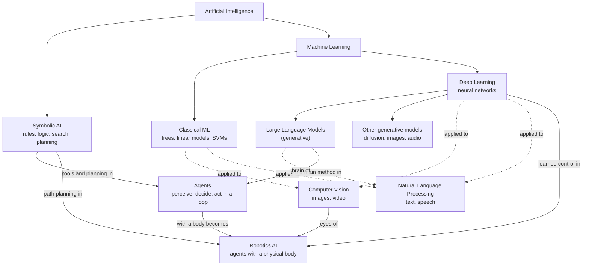

# Day 1: What Is Artificial Intelligence?

*100 Days of AI Engineering, Module 1: AI Foundations*

**Time:** about 3 hours
**Level:** beginner. No prior AI or machine learning experience is needed.

**By the end of this day, you will have:**

- An AI field map showing how ML, DL, CV, NLP, LLMs, agents and robotics AI relate
- A small project that runs the same message classifier two ways: with hand-written rules, then with a learned model
- A short comparison of where each approach makes mistakes

**What you need:**

- A computer with Python 3.10 or newer
- `pandas` and `scikit-learn` (installed in the project section)
- A blank page, paper or whiteboard tool for the field map

**Prerequisites:**

- Basic Python: variables, functions, lists
- How to read a CSV file
- No math is needed yet

---

## In this guide you are going to cover the following

- [Introduction](#introduction)
- [A short history, so the vocabulary makes sense](#a-short-history-so-the-vocabulary-makes-sense)
- [Artificial intelligence](#artificial-intelligence)
- [Machine learning](#machine-learning)
- [Deep learning](#deep-learning)
- [Generative AI](#generative-ai)
- [Narrow AI](#narrow-ai)
- [General intelligence as a concept](#general-intelligence-as-a-concept)
- [Symbolic vs statistical AI](#symbolic-vs-statistical-ai)
- [Predictive vs generative systems](#predictive-vs-generative-systems)
- [Training vs inference](#training-vs-inference)
- [Models, parameters and algorithms](#models-parameters-and-algorithms)
- [AI engineering vs ML engineering vs data science vs research](#ai-engineering-vs-ml-engineering-vs-data-science-vs-research)
- [The AI field map (today's output)](#the-ai-field-map-todays-output)
- [Hands-on exercises](#hands-on-exercises)
- [Project: a rule-based bot and a learned bot that solve the same problem](#project-a-rule-based-bot-and-a-learned-bot-that-solve-the-same-problem)
- [Check your understanding](#check-your-understanding)
- [Sources to read and watch](#sources-to-read-and-watch)
- [Tomorrow](#tomorrow)

---

## Introduction

Artificial intelligence (AI) is the field of building systems that do things we would call intelligent when a person does them: recognizing faces, understanding speech, translating text, playing games, planning routes, writing code. AI is not one technique. It is a family of approaches, and the most important split is between two of them: **hand-written rules** and **patterns learned from data**. Almost everything you will study in these 100 days lives on one side of that split or the other.

On the job, this vocabulary is how you scope work. When a client says "we want AI," your first questions are: is this a rules problem or a learning problem, do we need to predict or generate, and who pays for training versus inference? Today gives you the words for those questions.

[Wikipedia: Artificial intelligence](https://en.wikipedia.org/wiki/Artificial_intelligence) gives the full history. Read the introduction and the section on "Goals" today.

---

## A short history, so the vocabulary makes sense

| Period | What happened | Why it matters today |
|---|---|---|
| 1950 | Alan Turing asks "Can machines think?" and proposes the [Turing test](https://en.wikipedia.org/wiki/Turing_test). | Defined the question. Behavior, not internals, was the test. |
| 1956 | The [Dartmouth workshop](https://en.wikipedia.org/wiki/Dartmouth_workshop) coins the term "artificial intelligence." | The field gets its name. |
| 1959 | Arthur Samuel's checkers program improves by playing against itself, and the term "machine learning" spreads. | The first famous program that got better from experience instead of new code. |
| 1960s–1980s | **Symbolic AI**: programs manipulate symbols and logic rules. [Expert systems](https://en.wikipedia.org/wiki/Expert_system) encode a human expert's rules (medical diagnosis, machine configuration). | Rules are still used in many real products. Good when rules are known and stable. |
| 1980s–1990s | "AI winters": funding dried up after rule-based systems failed to scale to messy real-world problems. | Lesson: hand-written rules break on messy inputs. |
| 1997 | IBM's Deep Blue beats world chess champion Garry Kasparov using search and hand-tuned evaluation. | A narrow, mostly symbolic system reaching world-class level. |
| 1990s–2010s | **Statistical machine learning** grows: models learn patterns from data (spam filters, search ranking, recommendations). | The shift from "tell the machine the rules" to "show the machine examples." |
| 2012 onward | **Deep learning** (large neural networks trained on lots of data and compute) wins image recognition (AlexNet, 2012) and then speech, translation and games. | The engine behind modern AI. |
| 2017 onward | The [transformer](https://en.wikipedia.org/wiki/Transformer_(deep_learning_architecture)) architecture arrives. | Basis of today's large language models (covered in Module 8). |
| 2022 onward | [Generative AI](https://en.wikipedia.org/wiki/Generative_artificial_intelligence) becomes mainstream (ChatGPT launches in November 2022): systems that produce text, images, audio and code. | What most people now mean by "AI." |

**Takeaway:** AI has moved from rules written by people, to patterns learned from data, to very large learned models. Knowing this arc helps you judge which tool fits which problem.

---

### Artificial intelligence

A calculator does arithmetic better than any person, but nobody calls it intelligent, because the steps are fixed and obvious. A system that looks at a photo and says "that is a dog" feels different, because we cannot easily write down the steps. AI is the name for the second kind of task.

Strip the idea down and AI is three things:

1. A **task**: an input goes in, a useful output comes out (photo in, label out; question in, answer out).
2. A **method** for getting from input to output: rules a person wrote, a search over possibilities, or a function learned from examples.
3. A **measure** of how well it works: accuracy, win rate, time saved, errors caught.

If you cannot name all three for a system, you do not yet understand what the system does.

Put formally, artificial intelligence is the field of building machines that perform tasks we associate with human intelligence: perceiving, reasoning, learning, planning, using language and acting. It is defined by the **goal**, not by any single technique.

For example, a maps app that finds the fastest route is AI. It uses a search algorithm (such as [A*](https://en.wikipedia.org/wiki/A*_search_algorithm)) over a road graph, plus learned predictions of traffic. One product, two AI methods.

A common mistake is treating "AI" as a synonym for "chatbot" or "neural network." A route planner, a chess engine and a rule-based fraud check are all AI. Another trap is the **AI effect**: once a task is solved and routine (spell check, route finding), people stop calling it AI. The name moves on to the next unsolved task.

On the job, product managers and clients say "AI" loosely. Your job is to translate it into a specific task, method and measure before anyone writes code.

---

### Machine learning

You can teach a child what a cat is by giving a list of rules (four legs, whiskers, pointed ears), or by showing a hundred cats and a hundred non-cats. The second way is machine learning.

A normal program works like this:

```
rules + input  ──►  program  ──►  output
```

Machine learning flips it:

```
examples of (input, correct output)  ──►  learning algorithm  ──►  rules (a model)
```

The person supplies the examples. The algorithm finds the rules. Those rules are stored as numbers, not as readable `if` statements.

Formally, [machine learning](https://en.wikipedia.org/wiki/Machine_learning) (ML) is the subset of AI where a system improves its performance on a task from data instead of from explicitly coded rules. A definition often attributed to Arthur Samuel calls it giving computers "the ability to learn without being explicitly programmed."

Consider converting Celsius to Fahrenheit. The rule is `F = 1.8 × C + 32`. Suppose you did not know it and only had five measurements:

| C | F |
|---|---|
| 0 | 32 |
| 10 | 50 |
| 20 | 68 |
| 30 | 86 |
| 40 | 104 |

An ML algorithm can recover the rule from the table:

```python
import numpy as np

celsius = [0, 10, 20, 30, 40]
fahrenheit = [32, 50, 68, 86, 104]

slope, intercept = np.polyfit(celsius, fahrenheit, 1)  # fit a straight line
print(round(slope, 2), round(intercept, 2))            # 1.8 32.0
```

Nobody typed 1.8 or 32. The algorithm found them from examples. That is ML in five lines. Here a person could have written the rule, so ML was not needed. ML earns its keep when nobody can write the rule, as with "is this photo a cat?"

The usual mistake is reaching for ML when the rule is known and stable (tax brackets, unit conversions, password length). You add data collection, training and error rates to a problem that had none. The opposite trap: hand-writing hundreds of rules for a fuzzy problem (spam, sentiment) when a learned model would be smaller and better.

In industry, spam filters, credit scoring, demand forecasting, product recommendations and search ranking are all ML. Most "AI" in production at banks and retailers is classical ML on tables of data, not chatbots.

---

### Deep learning

Picture a factory assembly line. Raw pixels go in at one end. Each station transforms what it receives a little: the first finds edges, the next combines edges into shapes, the next combines shapes into eyes and ears, and the last says "cat." Each station is a **layer**. Many layers make the network **deep**.

Underneath, a single artificial neuron does very little:

```
output = activation(w1·x1 + w2·x2 + ... + wn·xn + b)
```

It multiplies each input by a weight, adds them up with a bias, and passes the total through a simple function. One neuron can only draw a straight dividing line. Stack thousands of them in layers, and the network can represent very complex patterns. Training sets every weight and bias.

So [deep learning](https://en.wikipedia.org/wiki/Deep_learning) (DL) is machine learning that uses [artificial neural networks](https://en.wikipedia.org/wiki/Neural_network_(machine_learning)) with many layers. The layers learn their own features from raw data, so you do not have to hand-design them.

Take the digit-recognizing network in the 3Blue1Brown video. It takes a 28 × 28 image (784 pixel values), passes it through two hidden layers of 16 neurons each, and outputs 10 scores, one per digit. Count the parameters:

| Connection | Weights | Biases | Total |
|---|---|---|---|
| 784 inputs → 16 | 784 × 16 = 12,544 | 16 | 12,560 |
| 16 → 16 | 16 × 16 = 256 | 16 | 272 |
| 16 → 10 outputs | 16 × 10 = 160 | 10 | 170 |
| **Network** | | | **13,002** |

A tiny network already has 13,002 numbers to learn. GPT-3 (2020) had 175 billion.

```
input (784) ──► hidden (16) ──► hidden (16) ──► output (10)
  pixels         edges?          shapes?         "this is a 7"
```

A frequent mistake is using deep learning on a small table of data. With 500 rows of customer records, a gradient-boosted tree (classical ML) usually beats a neural network and trains in seconds. Deep learning shines on large amounts of images, audio and text. Also, "the layers learn edges, then shapes" is a helpful story, not a guarantee. Real networks are harder to interpret.

Face unlock, speech-to-text, photo search, machine translation and every large language model run on deep learning. You will study it from Day 39.

---

### Generative AI

One art student can look at a painting and say "that is a Monet" (recognition). Another can paint a new picture in Monet's style (generation). Generative AI is the second student.

A generative model learns what typical data looks like: which words tend to follow which, which pixels tend to sit next to which. Then it **samples**: it produces a new example that fits those learned patterns. It does not copy and paste from a database; it builds output piece by piece from probabilities.

Formally, [generative AI](https://en.wikipedia.org/wiki/Generative_artificial_intelligence) is the set of models that produce new content (text, images, audio, video, code) rather than only labeling existing content. The main families today are **large language models** (LLMs) for text and code, and **diffusion models** for images and video.

A few examples:

| Input (prompt) | Model type | Output |
|---|---|---|
| "Write a polite refund email" | LLM (text) | A new email |
| "A red bicycle on a beach, watercolor" | Diffusion model (image) | A new image |
| "Python function that reverses a list" | LLM (code) | New code |

The danger is fluent output that is wrong. Generative models can produce confident, well-written, false statements, often called **hallucinations**. They optimize for "plausible," not "true." Every generative feature you ship needs a way to check its output: retrieval of real sources, tests for code, or a human review step.

In products, you see it in customer-support assistants, coding assistants, document summarizers and marketing-image tools. Building these reliably (retrieval, tool use, evaluation) is the core of AI engineering, covered in Modules 8 to 10.

---

### Narrow AI

A world-class chess engine cannot tell you whether a photo contains a cat. A world-class photo classifier cannot play chess. Each is brilliant inside its box and useless outside it.

Every AI system is trained or designed for a task and a **data distribution** (the kind of inputs it saw while being built). Inside that distribution it can be superhuman. Outside it, performance can collapse without warning, because nothing in the system knows it has left its box.

Narrow AI (also called weak AI) is AI built for one task or a limited set of tasks. Every AI system in use today is narrow, including the large ones.

Consider a skin-lesion classifier trained on photos of light skin, taken under clinic lighting. It can score well in testing. Show it a phone photo of darker skin in a dim room, and accuracy can drop sharply. Same task, different inputs, and it is now outside its box.

The mistake to avoid is assuming that strong performance on one task means general ability. LLMs blur this line: one model can write, summarize, translate and code. That breadth is real, but the model still fails in predictable ways (arithmetic on long numbers, facts after its training cutoff, tasks needing actions it cannot take). Test on your task; do not assume.

When you deliver an AI system to a client, you document its box: what inputs it was tested on, and what it should not be used for. That document is often called a **model card**.

---

### General intelligence as a concept

A person can learn chess on Monday, cooking on Tuesday and a new job on Wednesday, carrying lessons from one to the next. General intelligence is that ability to handle almost any task, including new ones, without being rebuilt for each.

"General" means three things together:

1. **Breadth:** competence across many different kinds of task.
2. **Transfer:** learning one thing makes the next thing easier.
3. **Adaptation:** handling situations nobody prepared it for.

Narrow systems usually have one of these at most.

[Artificial general intelligence](https://en.wikipedia.org/wiki/Artificial_general_intelligence) (AGI) is a hypothetical system with broad, human-level ability across most cognitive tasks. There is no agreed definition and no agreed test. Some organizations define it economically (OpenAI's charter talks about "highly autonomous systems that outperform humans at most economically valuable work"); researchers often define it by breadth and adaptability.

Compare a few systems on those three properties:

| System | Breadth | Transfer | Adaptation |
|---|---|---|---|
| Chess engine | No | No | No |
| Spam filter | No | No | Some (retraining) |
| Large language model | Wide | Some | Limited |
| Adult human | Wide | Strong | Strong |

Avoid treating AGI as either here already or impossible. Both claims are opinions, and experts disagree widely on the timeline. For engineering work, the useful question is narrower: does this system do my task reliably, on my inputs, at my cost?

On the job, AGI is a research goal and a public debate, not a deliverable. You will hear about it in news and investor decks. You will be paid to build narrow systems that work.

---

### Symbolic vs statistical AI

There are two ways to teach a new cashier which notes are fake. One manager hands over a rulebook: "check the watermark, the security thread, the color-shifting ink." Another lets the cashier handle a thousand real and fake notes until they can feel the difference. The first is symbolic; the second is statistical.

Side by side, they differ on every basic question:

| Question | Symbolic AI | Statistical (learned) AI |
|---|---|---|
| Where does knowledge come from? | A person writes it as rules or logic | Estimated from examples |
| What is stored? | Readable rules, facts, search procedures | Numbers (parameters) |
| Can you explain a decision? | Yes, point to the rule | Often only partly |
| What breaks it? | Inputs the author did not imagine | Inputs unlike the training data |
| How do you improve it? | Write more rules | Add data and retrain |

In short, [symbolic AI](https://en.wikipedia.org/wiki/Symbolic_artificial_intelligence) represents knowledge as human-readable symbols and rules, and reasons with logic and search. Statistical AI (machine learning) represents knowledge as numbers estimated from data.

Take deciding if an email is spam.

- **Symbolic version:** "If the subject contains 'free money' or the sender is on a blocklist, mark as spam." You know exactly why each email was flagged. It breaks the moment spammers change their wording.
- **Learned version:** show the system 10,000 emails labeled spam or not spam. It finds its own patterns in the words, senders and links. It adapts when you retrain, but you cannot always say exactly why one email was flagged.

Chess shows the same split over time. Deep Blue (1997) used search plus an evaluation function tuned largely by people. AlphaZero (2017) learned its evaluation by playing itself.

Do not treat the split as a contest with a winner. Real systems mix both. A bank runs a hard rule (block any transfer over the legal limit) next to a learned fraud model. An LLM assistant calls a calculator (symbolic, exact) instead of guessing arithmetic. Mixing the two is often called **hybrid** or **neuro-symbolic** AI.

Regulated industries (banking, insurance, healthcare) keep symbolic rules for anything a regulator must audit, and add learned models where patterns are too messy to write. Your project today builds one of each.

---

### Predictive vs generative systems

A predictive system is a judge holding up a scorecard. A generative system is a performer on stage. The judge looks at something that exists and says what it is. The performer makes something new.

Both kinds learn probabilities from data, and they differ in what they output:

- **Predictive (discriminative):** given input `x`, output a label or number `y`. "Given this email, how likely is spam?"
- **Generative:** output new data that looks like the training data. "Write an email that looks like a real one."

The link between them: a language model generates text by **predicting the next word, over and over**. Generation is prediction applied repeatedly to its own output.

Put precisely, a predictive system maps an input to a label, score or number. A generative system produces new samples (text, images, audio) that fit the patterns of its training data.

You can see both behaviors in a tiny next-word model built from one sentence:

```python
from collections import Counter, defaultdict

text = "the cat sat on the mat the cat ate".split()

next_words = defaultdict(Counter)
for current, following in zip(text, text[1:]):
    next_words[current][following] += 1

print(next_words["the"])   # Counter({'cat': 2, 'mat': 1})
print(next_words["cat"])   # Counter({'sat': 1, 'ate': 1})
```

- **As a predictor:** after "the," the model says "cat" with probability 2/3 and "mat" with 1/3.
- **As a generator:** start at "the," pick "cat," then pick a word that follows "cat," and keep going. You might get "the cat sat on the mat," a sentence the model built one prediction at a time.

An LLM does the same thing with a neural network instead of a counter, trained on vast amounts of text.

A costly mistake is using a generative model when a predictive one would do. Classifying 10,000 support tickets into five categories with an LLM costs far more per ticket than a small classifier, and gives answers that can vary from run to run. Use generation when the output must be new content; use prediction when the output is a fixed label or number.

In the market, predictive systems run churn prediction, fraud scores, demand forecasts and image tagging. Generative systems draft replies, write code and make images. Many products chain them: a classifier routes a ticket, then an LLM drafts the reply.

---

### Training vs inference

Training is a chef spending years learning to cook. Inference is the chef cooking one dish for a customer. The learning is slow and happens rarely. The cooking is fast and happens all day.

The two phases look like this:

```
TRAINING (rare, slow, expensive)
  data + labels ──► learning algorithm ──► adjusts parameters ──► saved model file

INFERENCE (constant, fast, cheap per call)
  new input ──► saved model (parameters frozen) ──► prediction
```

During training the parameters change. During inference they are **frozen**: the model uses them but does not update them.

**Training** is the phase where a model's parameters are adjusted using data. **Inference** is the phase where the trained model is used on new inputs to produce outputs.

Go back to the temperature model from the machine learning section.

```python
# Training: run once. Finds slope=1.8, intercept=32.
slope, intercept = np.polyfit(celsius, fahrenheit, 1)

# Inference: run every time someone needs an answer.
def predict(c):
    return slope * c + intercept

print(round(predict(25), 2))   # 77.0
```

The `polyfit` line is training. Each call to `predict` is inference. The model never learns from the 25 you passed in.

Two mistakes are common. The first is thinking a deployed model keeps learning from users. Most do not; the parameters stay fixed until someone retrains. The second is ignoring inference cost. Training a large model is a big one-time bill, but inference runs on every request. A model that serves millions of requests a day can cost more to run in a year than it cost to train.

On a team, ML engineers own training pipelines. AI engineers mostly work on the inference side: calling models through APIs, caching, batching and keeping latency and cost under control.

---

### Models, parameters and algorithms

Think of a recipe card with blanks: "Bake at ___ degrees for ___ minutes." The card is the **model** (the shape of the solution). The numbers you fill in are the **parameters**. The method you use to find good numbers (bake test batches, taste, adjust) is the **algorithm**.

These are three separate things that beginners blur together:

| Term | What it is | Temperature example | Day 1 project example |
|---|---|---|---|
| **Model** | The function that maps input to output | `F = w × C + b` | Bag of words + Naive Bayes |
| **Parameters** | The numbers inside the model | `w = 1.8`, `b = 32` | One number per (label, word) pair |
| **Algorithm** | The procedure that finds the parameters (training) or uses them (inference) | Least squares (`polyfit`) | Counting words per label, then `.predict` |

Stated precisely:

- A **model** is a function, designed or learned, that maps inputs to outputs.
- **Parameters** are the numbers inside a model that training adjusts. Modern LLMs have billions.
- An **algorithm** is a precise, finite sequence of steps that solves a problem. The training procedure is an algorithm; the trained model is the result.

In `F = w × C + b`, the model has 2 parameters. A model that predicts house price from size, rooms and age, `price = w1·size + w2·rooms + w3·age + b`, has 4. The 3Blue1Brown digit network from the deep learning section has 13,002. The algorithm that finds them can be the same idea in every case: adjust the numbers to reduce the error (gradient descent, Day 2).

Watch your wording. Do not say "the algorithm decided" when you mean "the model predicted." The algorithm ran during training and finished. The model is what makes predictions. Also keep **parameters** separate from **hyperparameters**: hyperparameters are settings you choose before training (how many layers, how long to train), and training does not change them. Day 2 covers this.

When a vendor says "our model has 70 billion parameters," you should immediately think: memory needed to load it, cost per request, and whether a smaller model would do your task.

---

### AI engineering vs ML engineering vs data science vs research

Think of a restaurant. The **researcher** invents a new cooking technique. The **ML engineer** builds a reliable kitchen that cooks it at scale. The **AI engineer** designs the dishes customers order, combining ready-made ingredients. The **data scientist** studies the sales figures to decide what should be on the menu.

The roles differ by the question each one owns:

| Role | Typical question | Typical output | Main tools |
|---|---|---|---|
| Data scientist | "What does the data say, and what decision should it support?" | Analyses, dashboards, statistical models | SQL, pandas, notebooks, statistics |
| ML engineer | "How do I train, evaluate and ship a model that works reliably?" | Trained models, pipelines, evaluation reports | scikit-learn, PyTorch, MLflow, Docker |
| AI engineer | "How do I build a product that uses AI models, retrieval, tools and evaluation?" | Applications, agents, LLM-powered features | LLM APIs, vector databases, eval tools, web frameworks |
| AI researcher | "Can we create a new method that works better?" | Papers, new architectures, new training methods | PyTorch or JAX, math, large compute |

These are job families, not strict boxes. Small companies merge them into one person; large companies split them further (data engineer, MLOps engineer, applied scientist).

Here is one feature with four people on it. A bank wants to cut fraud.

- The **data scientist** finds that fraud doubled on one payment channel and estimates the cost.
- The **ML engineer** trains a fraud classifier, sets up retraining every week and monitors its accuracy.
- The **AI engineer** builds an assistant that explains each flagged transaction to an analyst in plain language, using an LLM and the bank's own records.
- The **researcher** publishes a better method for detecting fraud rings in transaction graphs.

Do not pick a title before learning the skills. The overlap is large, and early in your career, a portfolio that shows you can take a problem from data to a working, evaluated system matters more than the label.

This 100-day program aims at **ML and AI engineering**, with enough data science to be useful and enough research literacy to read papers.

---

## The AI field map (today's output)

The field map shows how the areas you will hear about relate. Some names describe **methods** (how a system works), some describe **data or problem areas** (what it works on), and some describe **systems** that combine several parts. Mixing these up is why so many AI diagrams on the internet disagree.

### The methods: a set of nested boxes

```
┌────────────────────────── Artificial Intelligence ──────────────────────────┐
│  Symbolic AI: rules, logic, search, planning, expert systems                │
│                                                                             │
│  ┌──────────────────────── Machine Learning ─────────────────────────────┐  │
│  │  Classical ML: linear models, decision trees, SVMs, k-means           │  │
│  │                                                                       │  │
│  │  ┌───────────────────── Deep Learning ─────────────────────────────┐  │  │
│  │  │  CNNs, RNNs, transformers, diffusion models                     │  │  │
│  │  │                                                                 │  │  │
│  │  │  ┌──────────────── Large Language Models ────────────────────┐  │  │  │
│  │  │  │  Transformers trained on huge amounts of text             │  │  │  │
│  │  │  └───────────────────────────────────────────────────────────┘  │  │  │
│  │  └─────────────────────────────────────────────────────────────────┘  │  │
│  └───────────────────────────────────────────────────────────────────────┘  │
└─────────────────────────────────────────────────────────────────────────────┘
```

Every LLM is deep learning. Every deep learning system is ML. Every ML system is AI. None of these statements works in reverse.

### The problem areas: they cut across the boxes

**Computer vision (CV)** works on images and video. **Natural language processing (NLP)** works on text and speech. Both are older than deep learning. Early CV used hand-designed edge detectors; early NLP used grammar rules. Today both are dominated by deep learning, but classical methods still appear (a barcode scanner is CV without any learning).

| Area | Symbolic example | Classical ML example | Deep learning example |
|---|---|---|---|
| CV | Barcode and QR reading | Face detection with Haar features (2001) | Face unlock, medical image analysis |
| NLP | Grammar-based parsers, regex extractors | Naive Bayes spam filter (your project) | LLMs, speech-to-text |

### The systems: agents and robotics AI combine the parts

- An **agent** is a system that perceives its environment, decides, and acts toward a goal, in a loop. The idea is old: the classic textbook *Artificial Intelligence: A Modern Approach* by Russell and Norvig frames all of AI around agents. Today the word usually means an **LLM agent**: an LLM that plans steps, calls tools (search, code, APIs), reads the results, and repeats until the task is done. The LLM is the decision-maker; the tools are symbolic and exact.
- **Robotics AI** is AI in a physical body. A robot combines CV (cameras to see), sometimes NLP (spoken commands), planning (often symbolic search, such as path planning), control (classical engineering math) and learning (for example, reinforcement learning to learn to grasp). A robot is an agent whose actions move motors instead of calling APIs. Your Robotics series covers this side.

### The whole map in one picture



Solid arrows from the top are **is-a-subset-of** relationships (methods). Dotted arrows are **applied-to** relationships (methods used in a problem area). Labeled arrows show what each system borrows. GitHub and VS Code render Mermaid diagrams automatically; if yours does not, paste the code into the [Mermaid Live Editor](https://mermaid.live).

**Reference images to find:** search "AI vs ML vs deep learning diagram" and compare three of them. Most show only the nested circles in the methods part of the field map. Notice what they leave out: CV, NLP, agents and robotics, which do not fit inside one circle.

**Video (about 20 minutes):** [3Blue1Brown: But what is a neural network?](https://www.youtube.com/watch?v=aircAruvnKk). Watch it now. You will see the neurons, weights and layers from the deep learning section before you study them properly on Day 39.

---

## Hands-on exercises

**Exercise 1: Build your AI field map.**

1. Open a blank page, paper or whiteboard tool. Write the title "AI field map."
2. Without looking, draw the nested method boxes from the methods part of the field map: AI, symbolic AI, ML, classical ML, DL, LLMs.
3. Add CV and NLP so they overlap the boxes instead of sitting inside one, as in the problem areas part of the field map.
4. Add agents and robotics AI, with arrows showing what each borrows (see the systems part).
5. Compare with the whole map in one picture. Mark anything you missed with a star.
6. List five real products you use each week. Use these if you need ideas: a phone camera that finds faces, a maps app that suggests a route, a music app's recommendations, autocorrect, a voice assistant, a spam filter, a photo app that searches by "dog" or "beach."
7. Place each product on your map, and next to it write one line in this form: `Product: category, because <one reason>`. The category must be one of: symbolic, classical ML, deep learning, generative. If you are not sure, write `unsure, check later`. That is an honest answer, and you will revisit it on Day 2.

**Exercise 2: Problem sorting.**

Write the answer to each problem below in this form: `Problem number: rules, learning, or mix, because <one sentence>`. Do not look up anything. Use your best guess and the definitions from the symbolic vs statistical AI section.

1. Sort a list of names alphabetically.
2. Tell if a photo contains a cat.
3. Predict tomorrow's electricity demand for a city.
4. Answer questions about a PDF you upload.
5. Decide whether to approve a bank loan, given a hard legal rule that applicants must be 18 or older.
6. Convert a temperature from Celsius to Fahrenheit.
7. Flag a bank transfer above 10,000 dollars for review.
8. Detect fraudulent card payments from past transactions.
9. Suggest the next song in a playlist.
10. Check whether a password has at least eight characters and one digit.

**Answer key (check after you write your answers):** 1 rules. 2 learning. 3 learning. 4 mix (retrieval rules plus a language model). 5 mix (the age rule is a rule; the approval score is learned). 6 rules. 7 rules. 8 learning. 9 learning. 10 rules.

If you disagreed with three or more of these, reread the symbolic vs statistical AI section before the project.

**Exercise 3: Predictive or generative?.** For problems 2, 3, 4, 8 and 9 above, write `predictive` or `generative`. Answers: 2 predictive, 3 predictive, 4 generative (the answer is new text), 8 predictive, 9 predictive.

---

## Project: a rule-based bot and a learned bot that solve the same problem

This is the GitHub project for Day 1. It is a small comparison rather than a product, and you will see the difference between the two approaches with your own hands.

**Goal:** a Python program that classifies short messages as **greeting**, **question**, or **complaint**, first with hand-written rules, then with a small learned model. Then you compare where each one fails.

### Repository layout

```
day-01-what-is-ai/
├── README.md              # what you built, what you learned, where each approach failed
├── data/
│   └── messages.csv       # 30 labeled messages (you will copy them in step 2)
├── symbolic_bot.py        # rule-based classifier
├── learned_bot.py         # small learned classifier (bag of words + Naive Bayes)
├── compare.py             # runs both on every row and prints their mistakes
└── requirements.txt       # the two libraries this project needs
```

### Step 1: create the folder and a virtual environment

A virtual environment keeps this project's libraries separate from the rest of your computer. Run these commands in a terminal from the folder where you keep projects.

```bash
mkdir day-01-what-is-ai
cd day-01-what-is-ai
mkdir data
python -m venv .venv
```

Activate it:

- macOS or Linux: `source .venv/bin/activate`
- Windows (PowerShell): `.venv\Scripts\Activate.ps1`
- Windows (Command Prompt): `.venv\Scripts\activate.bat`

Your prompt should now start with `(.venv)`. Every command in this project assumes that you are inside the folder with the environment active.

### Step 2: write the dataset

Create `data/messages.csv` with exactly this content. It has 30 rows, 10 per label. Some rows are deliberately tricky, and the tricky rows are where the two approaches disagree.

```csv
text,label
Hi there!,greeting
Good morning team,greeting
Hello how are you doing today,greeting
Hey everyone,greeting
Good evening from the office,greeting
Hi hope you are well,greeting
Hello again,greeting
Morning! Hope the week is going well,greeting
Hey there long time no see,greeting
Greetings to the whole team,greeting
How do I reset my password?,question
When does the store open?,question
Where can I find my invoice?,question
Can you help me with my order?,question
What is the refund policy?,question
Is the service down right now?,question
Why was I charged twice?,question
Do you ship to Canada?,question
Could you tell me the opening hours.,question
Who do I contact about a damaged item?,question
This app keeps crashing and I am furious,complaint
Your delivery was three days late,complaint
The product arrived broken,complaint
This is the worst service I have ever used,complaint
Can you stop calling me?,complaint
I have been waiting two hours and nobody answered,complaint
My order was charged twice and I am angry,complaint
The screen is cracked and the box was damaged,complaint
Terrible experience I want my money back,complaint
I want to speak to a manager about this mess,complaint
```

The file has no commas inside the message text, so you do not need quotation marks. If you later write your own messages with commas, wrap the text in double quotes.

Check the count: `python -c "import pandas as pd; print(pd.read_csv('data/messages.csv')['label'].value_counts())"` should print 10 for each label.

### Step 3: the rule-based bot (`symbolic_bot.py`)

Create `symbolic_bot.py` with this code. Read the comments. Each rule is a decision a person made.

```python
"""Rule-based message classifier: humans write the rules."""

from __future__ import annotations

import re

GREETING_OPENERS = {"hi", "hello", "hey", "greetings", "morning", "good morning", "good evening"}
QUESTION_WORDS = {"how", "what", "when", "where", "why", "who", "can", "do", "does", "is", "are", "will"}
COMPLAINT_WORDS = {"crashing", "late", "broken", "furious", "angry", "terrible", "worst", "cracked", "damaged"}


def tokenize(text: str) -> list[str]:
    """Lowercase the text and split it into words. Punctuation is dropped."""
    return re.findall(r"[a-z']+", text.lower())


def classify(text: str) -> str:
    tokens = tokenize(text)
    if not tokens:
        return "unknown"

    # Rule 1: a question mark or a question word at the start means a question.
    if text.strip().endswith("?") or tokens[0] in QUESTION_WORDS:
        return "question"

    # Rule 2: any complaint word anywhere in the message means a complaint.
    if COMPLAINT_WORDS & set(tokens):
        return "complaint"

    # Rule 3: a greeting word in the first one or two words means a greeting.
    opener_two_words = " ".join(tokens[:2])
    if tokens[0] in GREETING_OPENERS or opener_two_words in GREETING_OPENERS:
        return "greeting"

    # No rule matched. The honest answer is "I don't know."
    return "unknown"


if __name__ == "__main__":
    for sample in ["Hi there!", "How do I reset my password?", "This app is broken"]:
        print(f"{sample!r} -> {classify(sample)}")
```

**Why the code matches whole words.** An earlier version used `text.startswith("do")`. That also matched "download" and "document," which are not questions. Splitting the text into words and checking each word fixes that. This is the kind of bug rule systems have: the rule is only as good as the author's idea of what the words mean.

### Step 4: the learned bot (`learned_bot.py`)

Create `learned_bot.py` with this code. Nobody writes rules about words here. The model counts the words in each training message and learns which counts go with which label.

```python
"""Learned message classifier: the model estimates patterns from examples."""

import pandas as pd
from sklearn.feature_extraction.text import CountVectorizer
from sklearn.model_selection import StratifiedKFold, cross_val_score
from sklearn.naive_bayes import MultinomialNB
from sklearn.pipeline import make_pipeline


def build_model():
    """Bag of words (count each word) feeding a Naive Bayes classifier."""
    return make_pipeline(CountVectorizer(lowercase=True), MultinomialNB())


if __name__ == "__main__":
    df = pd.read_csv("data/messages.csv")
    model = build_model()

    # 5 rounds: train on 4 folds, test on the fifth, then average the five scores.
    folds = StratifiedKFold(n_splits=5, shuffle=True, random_state=42)
    scores = cross_val_score(model, df["text"], df["label"], cv=folds)
    print("cross-validated accuracy:", round(scores.mean(), 2))

    model.fit(df["text"], df["label"])
    for text in ["Hey, what time is it?", "The package never arrived"]:
        print(f"{text!r} -> {model.predict([text])[0]}")
```

**Why cross-validation and not one split.** With 30 rows, a single train/test split leaves only 9 test rows. In one trial on this dataset, changing the random seed moved the score from 0.22 to 0.89. Five rounds, each testing on different rows, give a steadier number. You will study this properly on Days 28 and 63.

### Step 5: compare them (`compare.py`)

Create `compare.py` with this code.

```python
"""Run the rule-based and learned classifiers on every row and show where each one is wrong."""

import pandas as pd
from sklearn.model_selection import StratifiedKFold, cross_val_predict

import learned_bot
import symbolic_bot


def main():
    df = pd.read_csv("data/messages.csv")

    # The rules were written by hand, so they need no training split.
    df["symbolic"] = df["text"].apply(symbolic_bot.classify)

    # The learned model gets a prediction for each row from a model that never saw that row.
    # Without this, the score would measure memory, not learning.
    folds = StratifiedKFold(n_splits=5, shuffle=True, random_state=42)
    df["learned"] = cross_val_predict(learned_bot.build_model(), df["text"], df["label"], cv=folds)

    print(f"rows: {len(df)}")
    print(f"symbolic accuracy: {(df['symbolic'] == df['label']).mean():.2f}")
    print(f"learned accuracy:  {(df['learned'] == df['label']).mean():.2f}")

    mistakes = df[(df["symbolic"] != df["label"]) | (df["learned"] != df["label"])]
    print("\nRows where at least one approach is wrong:")
    print(mistakes.to_string(index=False))


if __name__ == "__main__":
    main()
```

**Read the symbolic number carefully.** The rule lists were written after looking at these same 30 rows, so the symbolic score is optimistic. A rule written to fit known examples often scores well on them and worse on new ones. You can test this yourself in the README (question 4).

### Step 6: requirements and run

Create `requirements.txt`:

```text
pandas>=2.0
scikit-learn>=1.3
```

Install and run:

```bash
pip install -r requirements.txt
python symbolic_bot.py
python learned_bot.py
python compare.py
```

Expected output. Your numbers should match these. If they differ slightly, your library versions differ, which is fine. Note the difference in the README.

```text
'Hi there!' -> greeting
'How do I reset my password?' -> question
'This app is broken' -> complaint
cross-validated accuracy: 0.57
'Hey, what time is it?' -> greeting
'The package never arrived' -> complaint
rows: 30
symbolic accuracy: 0.87
learned accuracy:  0.57
```

`compare.py` then prints the table of rows where at least one approach was wrong. Expect about 15 rows. Look at the `symbolic` and `learned` columns side by side. Some mistakes are made by only one approach, and those are the most useful rows.

### Step 7: write the README

In `README.md`, answer these questions in full sentences. Paste the accuracy table from your run at the top.

1. Which approach was more accurate on your data, and by how much? Give both numbers.
2. Give two examples where the rules failed and explain why. Hint: look for rows where `symbolic` is `unknown` or wrong. The row "Could you tell me the opening hours." has no question mark, so Rule 1 misses it.
3. Give two examples where the learned model failed and explain why. Hint: look at the words it could have learned from. With 30 rows, a word that appears once in training tells it almost nothing.
4. Remove the rule words you added after reading the data (keep only the question-start words and greeting words), then rerun `compare.py`. Did the symbolic accuracy drop? What does that say about how much the rule lists were tuned to this data?
5. If you added 100 more labeled messages, which approach would improve more? Why?
6. Which approach could you explain to a non-technical manager? Which one would they trust more on a new kind of message they had never seen?

### Done when

- `python compare.py` runs after `pip install -r requirements.txt`, and the output matches the expected output above (or differs only because of library versions, which you have noted).
- `data/messages.csv` has 30 rows, 10 per label.
- The README answers all six questions, and includes at least two failure cases for each approach.
- You can explain, without notes, the difference between a rule and a parameter. A rule is a decision a person wrote down. A parameter is a number inside a learned model that training adjusted. Nobody wrote the parameters of `learned_bot.py`; the fitting step set them from the data.

---

## Check your understanding

1. In one sentence, what is the difference between AI and machine learning?
2. Why is every deep-learning system also a machine-learning system, but not the other way round?
3. What is a parameter, and what changes it? Is it changed during inference?
4. Name two properties of symbolic AI that are still valuable today.
5. Why might a generative model be called a "predictive" model in one sense?
6. What is the difference between training and inference, and which one becomes the bigger cost for a popular product?
7. On your field map, why do CV and NLP not sit neatly inside the deep learning box?

**Answers (check after you try):**

1. AI is the broad goal of machines doing intelligent tasks. ML is one approach to AI, where behavior comes from data.
2. Deep learning is defined as machine learning with neural networks of many layers, so it is a kind of ML. Plenty of ML (decision trees, linear models, Naive Bayes) uses no neural network at all.
3. A parameter is a number inside a model. Training adjusts parameters. During inference they are frozen.
4. Explainability (you can read the rules) and reliability on well-understood, stable problems. Auditability for regulators is a third.
5. A language model is trained to predict the next token of text, so in that sense it is a predictor. A generated response is produced by repeating that prediction one token at a time.
6. Training is the one-time or occasional learning phase. Inference runs every time the model is used, so for a popular product it becomes the repeated, growing cost.
7. CV and NLP are problem areas defined by the data (images, text), not methods. They are solved with symbolic, classical ML and deep learning methods, so they overlap all three boxes.

---

## Sources to read and watch

**Read (reference):**
- [Wikipedia: Artificial intelligence](https://en.wikipedia.org/wiki/Artificial_intelligence)
- [Wikipedia: Machine learning](https://en.wikipedia.org/wiki/Machine_learning)
- [Wikipedia: Deep learning](https://en.wikipedia.org/wiki/Deep_learning)
- [Wikipedia: Generative artificial intelligence](https://en.wikipedia.org/wiki/Generative_artificial_intelligence)
- [Wikipedia: Artificial general intelligence](https://en.wikipedia.org/wiki/Artificial_general_intelligence)
- [Wikipedia: Symbolic artificial intelligence](https://en.wikipedia.org/wiki/Symbolic_artificial_intelligence)
- [Wikipedia: Expert system](https://en.wikipedia.org/wiki/Expert_system)
- [Wikipedia: Intelligent agent](https://en.wikipedia.org/wiki/Intelligent_agent)
- [Google Machine Learning Crash Course](https://developers.google.com/machine-learning/crash-course) (start with "Framing" and "Introduction to ML")
- [Harvard CS50's Introduction to Artificial Intelligence with Python](https://cs50.harvard.edu/ai/): watch the first lecture today, for the overall shape of the field.

**Tutorials:**
- GeeksforGeeks: search "Difference between Artificial Intelligence vs Machine Learning vs Deep Learning" on geeksforgeeks.org.
- GeeksforGeeks: search "Generative vs Discriminative models" on geeksforgeeks.org, for the predictive vs generative systems section.

**Watch:**
- [3Blue1Brown: But what is a neural network?](https://www.youtube.com/watch?v=aircAruvnKk) (about 20 minutes)
- [StatQuest with Josh Starmer](https://www.youtube.com/@statquest): search "machine learning basics" and watch one video.

**Practice:**
- [scikit-learn User Guide](https://scikit-learn.org/stable/user_guide.html): read the "Getting started" page only, for today.
- [Mermaid Live Editor](https://mermaid.live): paste the field map from the whole map in one picture and edit it into your own version.

**Note on links:** open each one once. If a page has moved, search its title; the content is what matters.

---

## Tomorrow

Day 2, **How Machines Learn**, introduces data, features, labels, loss and training in detail. Bring your field map, your answer key results from Exercise 2, and your `compare.py` output. You will revisit the learned bot and ask what exactly it learned: which words pushed a message toward each label.

**Next:** [Day 2: How Machines Learn](Day-02-How-Machines-Learn.md)
