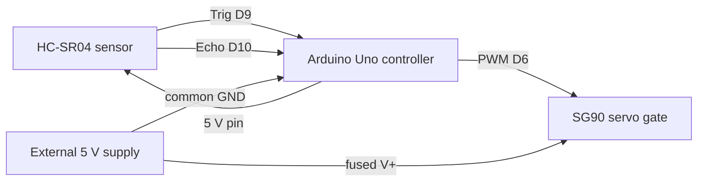

# Day 15: Electronics Project

*100 Days of Robotics Engineering, Module 2: Electronics for Robotics*

**Time:** about 6 hours, split over two sessions
**Level:** intermediate. You need Days 6 to 14. The project uses everything from this module in one small system, so it is the first day where a mistake in one stage shows up in another.

**By the end of this day, you will have:**

- A working sensor → controller → actuator system: an HC-SR04 ultrasonic sensor reads distance, an Arduino Uno decides whether a gate should be open, and an SG90 servo moves the gate
- A schematic and a wiring table that match the built system, drawn before you wired anything
- A calibration of the distance sensor against a ruler, with the error stated as a number
- A tested power path with a fuse, a bulk capacitor and a shared ground, and a written check that the servo's supply does not reset the controller
- A GitHub repository that documents the system well enough for someone else to build and test it

**What you need:**

- Arduino Uno Rev3 (ATmega328P) with Arduino IDE 2.3 or newer, about $25 for an official board or $10 to $15 for a clone
- HC-SR04 ultrasonic distance sensor module, about $2 to $4. It runs from 5 V and measures from about 2 cm to 4 m.
- SG90 micro servo (9 g, 180 degree), about $2 to $4. Its datasheet lists an operating voltage of 4.8 V to 6 V. Check the stall current listed on your datasheet, which is typically several hundred milliamps.
- A regulated 5 V supply rated at 2 A or more, such as a USB power adapter or a phone-style charger with a 5 V 2.4 A output, about $8 to $12. Alternatively, a bench supply set to 5.0 V with a current limit of 1.5 A.
- A resettable (PTC) fuse rated 1.1 A at 6 V or more, about $1, or an inline fuse holder with a 1 A fast-blow fuse as an alternative
- One 1000 µF electrolytic capacitor rated 16 V, about $0.50, and one 100 nF ceramic capacitor, about $0.10
- Breadboard, jumper wires and a three-pin header for the servo, about $5 for a kit
- Digital multimeter with DC volts and DC amps modes, about $15 to $25
- A metre ruler or a tape measure, a sheet of cardboard for a target, and a stopwatch or the Arduino's own timer
- Software: Arduino IDE 2.3 or newer, the Servo library that ships with it, and Git with a GitHub account
- Optional: Wokwi, the browser simulator with an Arduino Uno and an HC-SR04 model, for a first run before the hardware

**Prerequisites:**

- Day 2: the sense, compute and act loop
- Day 8: resistors, capacitors and connectors
- Day 9: the logic level of a pin
- Day 11: the ADC, the voltage divider and the noise from averaging
- Day 12: the power budget, the fuse and the star ground
- Day 13: the PWM signal and the flyback issues that apply to motors. The servo has its own internal motor, so the same protection thinking applies.
- Day 14: reading the HC-SR04 timing and the servo's operating conditions from the datasheet

---

## In this guide you are going to cover the following

- [Introduction](#introduction)
- [How sensing and actuation reached the hobbyist](#how-sensing-and-actuation-reached-the-hobbyist)
- [Glossary](#glossary)
- [The sensor stage](#the-sensor-stage)
- [The controller stage](#the-controller-stage)
- [The actuator stage](#the-actuator-stage)
- [Connecting the chain](#connecting-the-chain)
- [Hands-on exercises (about 60 minutes)](#hands-on-exercises-about-60-minutes)
- [Project: a sensor, controller and actuator system on GitHub](#project-a-sensor-controller-and-actuator-system-on-github)
- [Check your understanding](#check-your-understanding)
- [Sources to read and watch](#sources-to-read-and-watch)
- [Tomorrow](#tomorrow)

---

## Introduction

Every robot in this series so far has been a set of parts. Today you connect them into a loop. A sensor measures the world and turns it into a signal. A controller reads that signal, applies a rule and decides what should happen. An actuator takes the decision and moves something. The loop is the same one that Day 1 drew as four boxes, and it is the basis of a robot vacuum, a parking sensor, a gate opener and a warehouse pallet stop.

The project is deliberately small. An ultrasonic sensor, a microcontroller and a servo are cheap, and their failures are easy to see. The gate is incidental. The lesson is the discipline of drawing the system before you build it, measuring each stage against its datasheet, and documenting the result so that another person can reproduce it. That discipline is what a robotics employer checks first.

---

## How sensing and actuation reached the hobbyist

| Period | What happened | Why it matters for this project |
|---|---|---|
| 1917 to 1918 | Paul Langevin and colleagues develop an ultrasonic detector for submarines during the First World War. | The principle of sending sound and timing its echo dates from this period. |
| 1950s to 1960s | Ultrasonic rangefinders appear in cameras and industrial sensing. | Echo timing becomes a routine engineering method. |
| 1970s to 1980s | Hobby servos become available for model aircraft and cars. | A servo is a motor with a built-in position loop, controlled by a pulse width. |
| 2005 onward | Arduino brings the microcontroller and its libraries to students. | The Servo library and pulseIn make this project a few dozen lines. |
| Today | Low-cost sensor modules such as the HC-SR04 sell for a few dollars with a datasheet. | The timing and the supply limits in the datasheet are the first things to check. |

The servo and the ultrasonic sensor are old designs, but both are reliable when their datasheets are followed. Their failures usually come from the supply and the wiring, not from the principle.

---

## Glossary

- **Transducer:** a device that converts one form of energy into another, such as a piezoelectric element that turns an electrical pulse into sound and back.
- **Trigger pulse:** the short high pulse the controller sends to start a measurement.
- **Echo pulse:** the high pulse the sensor returns, whose width is the round-trip time of the sound.
- **Servo:** a motor with an internal position control loop, which holds a commanded angle.
- **Pulse width modulation (PWM) for servos:** a control signal with a fixed period of about 20 ms, where the high time sets the angle.
- **Hysteresis:** a difference between the thresholds for switching on and switching off, which prevents chattering when a signal sits near one threshold.
- **Calibration:** a comparison of a measurement against a known reference, which reveals the error and sometimes allows a correction.
- **Bulk capacitor:** a large capacitor on a supply rail that covers short current spikes.
- **Resettable fuse (PTC):** a fuse that increases its resistance when it overheats and recovers when the fault is removed.
- **Star ground:** the wiring pattern in which every subsystem returns to a single ground point, which is covered on Day 12.
- **Control loop:** the cycle of sensing, deciding and acting, repeated fast enough to hold the system at its target.

---

## The sensor stage

A bat finds a wall by sending a squeak and listening for the echo. The time between the two tells it how far away the wall is, because sound travels at a known speed. The HC-SR04 does the same with a pulse of ultrasound at about 40 kHz. The sensor is a transducer that turns electrical pulses into sound and back, and the controller reads the timing.

The key relation is time of flight. The sound travels to the object and back, so the round-trip distance is twice the range. At room temperature, the speed of sound is about 343 m/s, or 0.0343 cm/µs. The range in centimetres is:

d = (echo width in µs) × 0.0343 / 2

Equivalently, d = echo width / 58.3 when the width is in microseconds and the range is in centimetres. Most code uses 58, which is close enough for a gate.

The sensor's protocol is simple. The controller sends a trigger pulse of at least 10 µs on the Trig pin, after a short low period to clear the line. The sensor responds by sending eight ultrasonic pulses and raising its Echo pin. The Echo pin stays high until the echo returns, and its width is the round-trip time. If no echo returns, the Echo pin stays high until the sensor gives up, which takes about as long as a 4 m round trip, roughly 23 ms. The datasheet recommends waiting about 60 ms between measurements so that the echoes from one measurement do not confuse the next.

Here are two worked examples. An echo width of 1000 µs gives d = 1000 / 58.3 = 17.2 cm. An echo width of 350 µs gives d = 350 / 58.3 = 6.0 cm. The conversion is linear, so doubling the echo width doubles the distance.

Ultrasonic ranging depends on the surface and the angle. A soft cloth or a sloped surface may absorb or deflect the sound and return no echo, and the reading may be wrong or missing. A reading from a flat, hard surface at a right angle is the most reliable, and the test in the exercises uses that case. The sensor also depends on the air temperature, and the 343 m/s figure is for about 20 degrees Celsius. At 0 degrees Celsius, the speed is about 331 m/s, which changes the distance by about 3.5 percent.

The common mistake is to read the trigger and echo pins on the wrong side of the module. The module's Trig pin is an input to the sensor and the Echo pin is an output from it. Reversing them gives no reading, and the code appears to hang while it waits for an echo. Check the pin labels against the datasheet and the wiring table before you apply power.

On the job, time-of-flight sensors are in parking aids, warehouse robots and the proximity sensors in some phones. Modern laser time-of-flight sensors use the same time relation with light instead of sound.

---

## The controller stage

A thermostat turns a temperature reading into a decision: heat on or heat off. The controller in this project does the same with distance. It reads the sensor, compares the result with two thresholds, and sets the gate's state. The logic is small, but it has to be correct under noise and at the edges of the range.

The logic rests on the thresholds and the hysteresis. If the gate opens when the distance falls below 15 cm and closes when it rises above 15 cm, a reading that hovers at 15 cm makes the gate chatter. Two thresholds fix it: open below 15 cm, close above 20 cm. The gap between them, 5 cm, is the hysteresis band. Inside the band, the gate keeps its previous state.

The controller also needs a timing rule. The loop must measure, decide and write the servo at a steady rate. The starter code waits 60 ms between cycles, which matches the sensor's recommended measurement interval. A loop that waits longer is slower to respond, and a loop that waits shorter may read echoes from the previous measurement.

The starter code is below. It measures distance, applies the hysteresis rule, drives the servo and prints a status line over serial for the calibration work.

```cpp
#include <Servo.h>

const int TRIG_PIN = 9;
const int ECHO_PIN = 10;
const int SERVO_PIN = 6;               // PWM-capable pin on the Uno
const int OPEN_ANGLE = 90;
const int CLOSED_ANGLE = 0;
const float NEAR_CM = 15.0;            // open when closer than this
const float FAR_CM = 20.0;             // close when farther than this
const unsigned long ECHO_TIMEOUT_US = 30000UL;   // about 5 m of range

Servo gate;
bool gateOpen = false;

float readDistanceCm() {
  digitalWrite(TRIG_PIN, LOW);
  delayMicroseconds(2);
  digitalWrite(TRIG_PIN, HIGH);
  delayMicroseconds(10);
  digitalWrite(TRIG_PIN, LOW);
  unsigned long duration = pulseIn(ECHO_PIN, HIGH, ECHO_TIMEOUT_US);
  if (duration == 0) {
    return -1.0;                       // no echo received
  }
  return duration / 58.0;
}

void setup() {
  Serial.begin(9600);
  pinMode(TRIG_PIN, OUTPUT);
  pinMode(ECHO_PIN, INPUT);
  gate.attach(SERVO_PIN);
  gate.write(CLOSED_ANGLE);
  Serial.println("distance_cm,gate");
}

void loop() {
  float d = readDistanceCm();

  if (d >= 0) {
    if (!gateOpen && d < NEAR_CM) {
      gateOpen = true;
    } else if (gateOpen && d > FAR_CM) {
      gateOpen = false;
    }
  }
  // If there is no echo, the gate keeps its previous state.

  gate.write(gateOpen ? OPEN_ANGLE : CLOSED_ANGLE);

  Serial.print(d, 1);
  Serial.print(",");
  Serial.println(gateOpen ? "open" : "closed");

  delay(60);
}
```

The timeout of 30 ms in `pulseIn` covers the sensor's full range with margin, because at 343 m/s the 4 m maximum needs about 23.3 ms. If the sensor reports no echo, the function returns zero and the gate keeps its state. That rule is a deliberate choice: an unplugged sensor should not open or close the gate at random.

The controller's weak point is the single reading. One noisy echo can cross the threshold, and the gate reacts to it. The fix is to take the median of three or five readings, which the exercises ask you to add. A median is more robust than an average against a single outlier.

The common mistake is to use the same threshold for opening and closing. The gate then flickers each time a person stands at the edge of the band. The way to spot it is to watch the serial output while holding an object at about 15 cm. If the status line flips with every reading, the hysteresis is missing or too narrow.

The decision logic is often a state machine with hysteresis, debounce and timeouts. Home automation, HVAC controllers and garage door sensors all use this pattern.

---

## The actuator stage

A hand on a steering wheel is an actuator that the driver's brain commands. A servo is an actuator that a controller commands with a pulse. It contains a small motor, a gearbox, a potentiometer that measures the shaft's position and a control circuit that drives the motor until the shaft reaches the commanded angle.

Two things matter: the pulse width and the supply. The servo expects a pulse every 20 ms, and the width of the pulse sets the angle. A width of 1.0 ms commands 0 degrees, 1.5 ms commands 90 degrees and 2.0 ms commands 180 degrees, for a typical SG90. A pulse of 1.5 ms in a 20 ms period has a duty cycle of 1.5 / 20 = 7.5 percent, which is the number a timer would use. The Arduino's Servo library generates this signal for you on any pin it attaches.

The supply is the part that breaks projects. An SG90 runs from 4.8 V to 6 V, and its stall current is several hundred milliamps. When it moves, its motor draws a current spike that pulls down the supply. If the servo is powered from the Uno's 5 V pin, that spike can brown out the Uno's own regulator, the sensor or the USB connection, and the symptoms look like a software fault. The rule is to power the servo from a separate supply rated for the stall current, with a fuse in its positive lead and a bulk capacitor at the servo's connector.

Here is the calculation for the fuse. Suppose a datasheet lists a stall current of 0.7 A. A fuse rated at 125 to 150 percent of that gives 0.9 to 1.05 A. A 1.1 A resettable fuse is a reasonable choice, and it protects the wiring if the servo's gears jam and it holds current. A servo that stalls for a long time at 0.7 A dissipates heat in its motor, and the datasheet limit for stall duration should be respected. The project asks you to measure the servo's current in the exercises, so the fuse choice is confirmed on your own hardware.

A hobby servo's limits are its precision and its gear wear. A plastic-geared SG90 has backlash and an angle error of several degrees, and it wears after heavy use. It is adequate for a gate that opens and closes, and not adequate for a precision positioning system. Choose the actuator for the accuracy the task actually needs.

The common mistake is to command the servo to a fixed angle without limits. A servo commanded past its mechanical stop draws stall current until its supply protection trips. The fix is to keep the commanded angles between 0 and 180 and to test the gate's travel against its mechanical stop with the power limited.

On the job, hobby servos appear in prototypes and consumer products, and industrial actuators use the same control principle with stronger motors and encoders. The project's controller pattern, a command and a feedback loop, is the same.

---

## Connecting the chain

A chain is as strong as its weakest link, and in an electronic system the weak link is often the shared wire. The sensor, the controller and the actuator each have a supply, a ground and a signal. The project works only if those connections are made on purpose and checked.

Three things matter: the common ground, the power paths and the timing. Every signal is measured against a ground, so the sensor, the controller and the servo must share one ground reference. The servo's stall current flows from its supply and returns through the ground, so the ground wire to the servo must not carry that current through the sensor's return. The power paths are separate: the Uno runs from USB, the sensor from the Uno's 5 V pin, and the servo from the external supply with its fuse. The timing path is the trigger, echo and PWM signal lines, which have no current to speak of.

The wiring table below is the single source of truth for the build. Fill it in before you wire anything, and check each row against the built board.

| From | To | Wire colour | Purpose |
|---|---|---|---|
| Uno 5 V | HC-SR04 VCC | red | Sensor power, about 15 mA |
| Uno GND | HC-SR04 GND | black | Sensor ground |
| Uno D9 | HC-SR04 Trig | yellow | Trigger pulse out |
| Uno D10 | HC-SR04 Echo | green | Echo pulse in |
| Uno D6 | Servo signal | orange | PWM control signal |
| External 5 V through 1.1 A fuse | Servo V+ (red wire) | red | Servo power |
| External supply GND | Servo GND (brown wire) | black | Servo return |
| External supply GND | Uno GND | black | Common ground |

The chain in one diagram looks like this:



The bulk capacitor sits across the servo's V+ and GND, as close to the servo connector as the wiring allows. The 100 nF ceramic capacitor sits across the same pair, closer still. Together they absorb the servo's current spikes so that the Uno's supply does not see them. That is the decoupling principle from Day 12, applied to a single servo.

The honest limitation of a shared ground is that it is a compromise. Two grounds that are joined at one point are safe, and two grounds joined at several points can form a loop that picks up noise. The design uses one joining point, at the Uno's GND pin, and the rest of the ground runs as a star.

The common mistake is to omit the common ground between the external supply and the Uno. The servo's PWM signal is then referenced to a different ground, and the servo may jitter or ignore the signal. The fix is the black wire from the supply's GND to the Uno's GND, and the check is a multimeter measurement between the two grounds, which should read close to 0 V.

In the market, a robot's power and signal chain is laid out in exactly this way. The careful separation of power and ground is the difference between a sensor that works and a sensor that works only when the motors are off.

---

## Hands-on exercises (about 60 minutes)

Work with the 5 V supply connected only after you have checked the wiring table against the board. Do not power the servo from the Uno's 5 V pin.

1. **Draw the system before wiring it.** On paper or in KiCad, draw the wiring table and the chain diagram. Mark each supply, each ground and each signal. Check the pin labels on your actual sensor and servo against the datasheets. Only then start the breadboard.

2. **Bring up the sensor alone.** Wire the HC-SR04 to the Uno's 5 V, GND, D9 and D10 pins. Upload a short sketch that prints the echo width in microseconds every 100 ms. Hold a flat cardboard target at about 20 cm and confirm the echo width is about 1170 µs, which is 20 × 58.3. If the number is missing, check the Trig and Echo wires first.

3. **Calibrate against a ruler.** Place the cardboard at 5, 10, 20, 30 and 50 cm from the sensor, measured with the ruler from the front face of the sensor. At each distance, record 20 readings from the sketch and average them. Compute the error as (measured − true) / true, as a percentage. A good result is within about 3 percent. Write the table in the repo, and note any distance where the error is larger.

4. **Bring up the servo alone.** With the servo powered from the external supply and its signal on D6, upload a sketch that sweeps the servo from 0 to 180 degrees and back, with a one-second pause at each end. Confirm the sweep is smooth and that the servo does not hum at its end stops. Measure the supply current with the multimeter in series while the servo is held at a stop. Record the value, and compare it with the stall current in the datasheet.

5. **Verify the power path.** With the servo running its sweep, measure the 5 V supply voltage at the Uno's 5 V pin and at the servo's V+ pin. Record the drop at each pin during the sweep. Confirm that the Uno's 5 V pin stays above 4.7 V during the servo movement, and that the Uno does not reset.

6. **Run the full system and test the hysteresis.** Upload the starter code. Move the cardboard slowly from 30 cm to 10 cm and back. Record the serial output. The gate should open once, below 15 cm, and close once, above 20 cm. Hold the cardboard at 17 cm for 10 seconds and confirm the gate does not chatter. Then remove the echo wire while the gate is open and confirm the gate holds its state.

7. **Improve the reading with a median.** Change the controller to take three readings in a row and use their median. Repeat the test at 17 cm for 30 readings, with and without the median, and record how many times the gate's state changes.

Stop and disconnect the external supply if the servo's housing becomes hot to the touch, if the Uno resets when the servo moves, or if the fuse opens. Find the cause before you continue.

---

## Project: a sensor, controller and actuator system on GitHub

This project is the full system, documented for another person to build. It is the deliverable that shows the module's skills working together: the calculations, the wiring, the measurements and the write-up.

**Goal:** build and document a distance-triggered gate. An HC-SR04 sensor measures distance, an Arduino Uno applies hysteresis to decide whether the gate is open, and an SG90 servo moves the gate. The repo must contain everything needed to rebuild the system and verify its behavior.

**Repo layout:**

```
100-days-robotics-engineering-day-15-electronics-project/
├── README.md
├── firmware/
│   └── sensor_gate/
│       └── sensor_gate.ino
├── docs/
│   ├── wiring_table.md
│   ├── system_diagram.md
│   ├── power_path.md
│   └── safety.md
├── measurements/
│   ├── calibration.csv
│   ├── servo_current.md
│   ├── supply_voltage_during_sweep.csv
│   └── hysteresis_test.csv
├── analysis/
│   ├── calibration_error.py
│   └── requirements.txt
└── images/
    ├── breadboard.jpg
    └── wiring_closeup.jpg
```

**Starter analysis:** `analysis/calibration_error.py`

```python
import csv

def load(path):
    with open(path, newline="") as f:
        return list(csv.DictReader(f))

rows = load("measurements/calibration.csv")
# Expected columns: true_cm, reading_1, reading_2, ..., reading_20

for row in rows:
    true_cm = float(row["true_cm"])
    readings = [float(v) for k, v in row.items() if k.startswith("reading_")]
    mean_cm = sum(readings) / len(readings)
    error_pct = (mean_cm - true_cm) / true_cm * 100
    print(f"true={true_cm:5.1f} cm  mean={mean_cm:6.2f} cm  error={error_pct:+6.2f} %")
```

Run it from the repo root with Python 3.10 or newer. The output should show one line per distance, with the error in percent.

**Step-by-step tasks:**

1. Create the repo and write the README with the goal, the parts list and the photo of the breadboard.
2. Fill `docs/wiring_table.md` and `docs/system_diagram.md` before wiring. Update them if the built board differs, and record the reason.
3. Write `docs/power_path.md` with the supply rating, the fuse rating and the stall current from the servo datasheet, with the calculation.
4. Run the sensor bring-up and the calibration. Save the readings in `measurements/calibration.csv` and run `calibration_error.py`. Put the output in the README.
5. Measure the servo's stall current and the supply voltage during the sweep. Save them in `measurements/servo_current.md` and `measurements/supply_voltage_during_sweep.csv`.
6. Run the hysteresis test and save the gate's state changes in `measurements/hysteresis_test.csv`. Count the chatter events and report the number.
7. Write `docs/safety.md` with the current and voltage limits, the fuse, the rule against powering the servo from the Uno, and the stop conditions from the exercises.
8. Push the repo to GitHub and check that a fresh clone has every file the README names.

**README checklist:**

- [ ] Goal and one photo of the working system
- [ ] Parts list with the cost of each part
- [ ] Wiring table and system diagram
- [ ] Power path with fuse and stall current calculation
- [ ] Calibration table and error
- [ ] Servo current and supply voltage measurements
- [ ] Hysteresis test result
- [ ] Safety notes
- [ ] Known limitations, with at least one measured number

**Done when:**

- The gate opens below 15 cm and closes above 20 cm in the recorded test, with no chatter at 17 cm for 10 seconds.
- The calibration error is within 3 percent for distances from 10 cm to 30 cm, or the README explains the difference.
- The Uno's 5 V pin stays above 4.7 V during the servo sweep, or the power path is changed and the change is documented.
- The wiring table matches the built board, and any difference is noted with its reason.
- A fresh clone of the repo contains every file the README names, and `calibration_error.py` runs without error.

**Evidence to commit to GitHub:** the firmware, the analysis script, the measurement files, the wiring and power documentation, the photos and the README with the results. The reviewer should be able to rebuild the system from the repo and see the same behavior.

**Why this project is a full build:** it uses a fused power supply, a servo that moves a mechanical part and a sensor that reads a physical world, so it carries real electrical and mechanical hazards. Keep the external supply's current limit set, keep the fuse in place, and keep fingers clear of the servo horn. A servo can pinch a finger when it moves, and a gate that stalls against a jam can overheat the servo. Stop the test if anything becomes hot, smells or resets. Do not connect this system to mains power, and do not connect it to a building's wiring.

---

## Check your understanding

1. An HC-SR04 returns an echo width of 4.5 ms. Calculate the distance in centimetres, and state whether it is inside the sensor's 4 m range. Then explain what the controller should do if the echo width is 0 ms.
2. The gate opens at 15 cm and closes at 15 cm, with no hysteresis. Describe the behavior when the object is held at 15 cm, and explain how the 15 cm and 20 cm thresholds fix it.
3. A servo's control pulse is 2.0 ms in a 20 ms period. Calculate its duty cycle and the angle the servo should reach, assuming a typical SG90 mapping of 1.0 ms to 0 degrees and 2.0 ms to 180 degrees.
4. A servo's stall current is 0.8 A. Choose a fuse rating that follows the 125 to 150 percent rule, and explain why the fuse must sit in the positive lead close to the supply.
5. The Uno resets each time the servo starts moving, but the Uno's firmware is correct. Name the most likely cause, and describe two measurements that confirm it.
6. A calibration test gives an average reading of 21.5 cm at a true distance of 20 cm. Compute the error in percent, and decide whether it is within the target of 3 percent. Then name one physical cause that could produce this error.

---

### Answers

1. The echo width is 4.5 ms, which is 4500 µs. The distance is 4500 / 58.3 = 77.2 cm, or 0.77 m, well inside the 4 m range. An echo width of 0 ms means no echo was received within the timeout, so the controller should treat the reading as invalid and keep the gate in its present state, as the starter code does.
2. With no hysteresis, a reading that fluctuates around 15 cm crosses the single threshold on each cycle, so the gate opens and closes repeatedly. The 15 cm open threshold and the 20 cm close threshold create a band in which the gate holds its state, so a reading of 17 cm keeps the gate where it is, and only a clear crossing of either threshold changes it.
3. The duty cycle is 2.0 / 20 = 10 percent. The pulse of 2.0 ms maps to 180 degrees on a typical SG90, which is the far end of its travel. The controller should command 180 degrees, and the servo should be checked against its mechanical stop so it does not stall.
4. The stall current is 0.8 A. A fuse at 125 to 150 percent is 1.0 to 1.2 A, so a 1.1 A resettable fuse is a suitable choice. The fuse must sit in the positive lead near the supply, so that a short anywhere along the servo's wiring is interrupted, and the wiring is protected as well as the servo.
5. The most likely cause is a brownout from the servo's current spike, which pulls down the supply the Uno shares with the servo. Two measurements confirm it: measure the Uno's 5 V pin with a multimeter during the sweep and see whether it drops below about 4.7 V, and check whether the Uno resets when the servo is powered from a separate supply with its ground joined. If the reset stops with the separate supply, the cause is confirmed.
6. The error is (21.5 − 20) / 20 × 100 = 7.5 percent, which is outside the 3 percent target. A physical cause could be that the sensor is not perpendicular to the target, so the echo arrives late and the reading is long, or that the speed of sound is different from the assumed value because the air is warmer or colder than 20 degrees Celsius. A shift of this size from the air temperature alone is too small to explain 7.5 percent, so the angle or the surface is the more likely cause.

---

## Sources to read and watch

*Read*

- [Wikipedia: Ultrasound](https://en.wikipedia.org/wiki/Ultrasound) for the principle of sound-based sensing and the frequencies involved.
- [Wikipedia: Servomechanism](https://en.wikipedia.org/wiki/Servomechanism) for the feedback principle behind the servo.
- [Wikipedia: Servo motor](https://en.wikipedia.org/wiki/Servo_motor) for the motor and its position control.
- [Wikipedia: Hysteresis](https://en.wikipedia.org/wiki/Hysteresis) for the concept behind the two thresholds.
- [Wikipedia: Control loop](https://en.wikipedia.org/wiki/Control_loop) for the sense, decide and act cycle.
- The HC-SR04 datasheet, available from the module's supplier or from a distributor such as Digi-Key. Search "HC-SR04 datasheet" and read the timing diagram and the timing table.
- The SG90 datasheet, from the servo's supplier. Search "SG90 servo datasheet" and read the operating voltage and the stall current.
- The Arduino Language Reference at docs.arduino.cc, for the pulseIn function and the Servo library.

*Tutorials*

- Arduino Project Hub and the Arduino official tutorials, for the HC-SR04 and the servo. Search "Arduino HC-SR04 tutorial" and "Arduino servo tutorial" on docs.arduino.cc or projecthub.arduino.cc.
- SparkFun Learn, the guides on servo motors and on the ultrasonic distance sensor. Search "SparkFun Learn servo motors".
- Adafruit Learning System, the guide on servo motors and power. Search "Adafruit servo power guide".

*Watch*

- MIT OpenCourseWare, 6.002 Circuits and Electronics. The lectures on the RC circuit and the transients explain the bulk capacitor on the servo supply.
- Ben Eater's YouTube channel. Search his videos on microcontrollers and on building on breadboard, which show the same bring-up habits used here.

*Practice*

- Wokwi, the browser simulator. It includes an Arduino Uno, an HC-SR04 model and a servo, so you can run the starter code and test the hysteresis before you wire the hardware.

---

## Tomorrow

This project closes Module 2. You have now taken a signal from a physical sensor through the conditioning, the power, the driver and the timing, and you have documented each stage. The next module builds on the loop you made today, with more capable controllers and sensors. The habits to carry forward are the ones this module drilled: draw the system first, check every rating against the datasheet, measure each stage on the bench, and write down what you measured.
