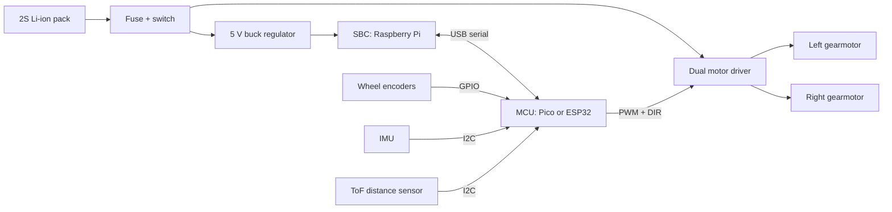

# Day 2: Anatomy of a Robot

*100 Days of Robotics Engineering, Module 1: Robotics Engineering Foundations*

**Time:** about 4 hours
**You will build:** a hardware and software architecture for a small wheeled mobile robot, with every block mapped to a real class of part.
**You should know:** Day 1 (the sense, decide, act loop, and open vs closed loop). No electronics knowledge yet.

---

## 1. The big idea

Yesterday you drew a robot as four boxes: sensors, compute, actuators and feedback. Today you open the boxes. A real robot is a stack of layers: a mechanical body, a power system, electronics that switch current into motors, a microcontroller running firmware, and usually a larger computer running high-level software. Most failures happen at the boundaries between layers. A motor browns out the computer. A sensor sits on the wrong bus. Firmware cannot keep up with its control loop. When an interviewer asks you to "walk me through the architecture," they want to hear that you know these layers and how they connect.

The sections below go from the bottom of the stack to the top, in the order the diagram in Section 3 reads.

## 2. How compute moved onto the robot

Early industrial robots were fixed machines. Unimate, the first industrial arm, went to a General Motors plant in 1961 and stored its program on a magnetic drum. Through the 1970s and 1980s, the computer lived in a cabinet beside the robot. Cheap microcontrollers in the 1990s and 2000s put real-time control on the robot itself. Arduino (2005) made microcontrollers easy for students, ROS (from 2007) made robot software shareable, and the Raspberry Pi (2012, about $35) brought a full Linux computer to small robots. ROS 2 replaced ROS 1 in 2017, and NVIDIA Jetson boards brought GPUs to small robots.

The result is a split. A small real-time chip runs the fast loops, and a larger general-purpose computer runs planning and perception. Nearly every design in this course uses some version of that split.

## 3. The map of a mobile robot

Here is Day 1's loop, expanded into the layers you will meet in this series.

```
 ┌─────────────────────────── HIGH-LEVEL SOFTWARE (SBC, Linux, ROS 2) ───────────────────────────┐
 │  mapping / localization   path planning   perception (camera, LiDAR)   teleop / UI   logging  │
 └───────────────────────────────────────────────▲───────┬───────────────────────────────────────┘
                                 odometry, IMU    │       │  velocity commands
                                                  │       ▼
 ┌──────────────────────────────── FIRMWARE (MCU, real time) ─────────────────────────────────────┐
 │  read encoders + IMU   wheel speed PID   motor PWM output   safety watchdog   battery monitor   │
 └──────▲─────────────▲──────────────────────────┬────────────────────────────────────────────────┘
        │ I2C         │ GPIO pulses               │ PWM + direction
 ┌──────┴─────┐ ┌─────┴──────┐            ┌───────▼───────┐                  ┌─────────────┐
 │ IMU,       │ │ Wheel      │            │ MOTOR DRIVER  │── high current ─▶│ DC MOTORS   │
 │ distance   │ │ encoders   │            │ (H-bridge)    │                  │ + gearbox   │
 └────────────┘ └────────────┘            └───────────────┘                  └─────────────┘

 POWER:      battery ─▶ fuse ─▶ switch ─┬─▶ motor driver (raw battery voltage)
                                        ├─▶ 5 V regulator ─▶ SBC
                                        ├─▶ 3.3 V regulator ─▶ MCU and sensors
                                        └─▶ voltage divider ─▶ MCU ADC pin (battery monitor)

 MECHANICS:  frame, motor mounts, wheels, bearings, caster (holds and carries everything above)
```

Read it from the bottom up. The frame holds everything. Power feeds everything. Electronics move current. Firmware closes the fast loops, and high-level software makes slower, smarter decisions.

The TurtleBot3 Burger from ROBOTIS follows this split. A Raspberry Pi runs ROS 2, an OpenCR board (an STM32 microcontroller) runs firmware, two Dynamixel smart servos drive the wheels, and a small 360-degree LiDAR scans the room.

**Reference image to find:** search "TurtleBot3 Burger hardware components" on the ROBOTIS e-Manual and match each labeled part to a box above.

## 4. Frames, joints and transmissions

**Intuition.** A motor is a sprinter: fast, but weak. A transmission trades speed for force, like a weightlifter. The frame is the skeleton that keeps everything in place while forces push and pull on it.

- **Frame (chassis):** the structure. Common materials are laser-cut acrylic (cheap, brittle), 3D-printed PLA or PETG (fast to iterate), aluminum extrusion (strong, modular) and sheet metal.
- **Joints:** places where parts move relative to each other. A revolute joint rotates (an elbow, a wheel axle). A prismatic joint slides (a linear rail). Each joint usually adds one degree of freedom (DOF), one independent way to move.
- **Transmissions:** spur gear trains, planetary gearboxes, belts and pulleys, lead screws, and harmonic drives (strain-wave gears, used in precise arms). Bearings carry the load so the motor shaft does not have to.

**Worked example.** A motor spins at 10,000 rpm with no load and gives 0.01 N·m of torque. You add a 50:1 gearbox at 80 percent efficiency.

- Output speed: 10,000 / 50 = 200 rpm.
- Output torque: 0.01 × 50 × 0.8 = 0.4 N·m.
- With a 65 mm wheel, ground speed: π × 0.065 × 200 / 60 ≈ 0.68 m/s.

A 100:1 gearbox gives about 0.34 m/s with twice the torque. Choosing a gear ratio means choosing a point on the speed-versus-strength curve.

**Common mistakes.**
- Hanging a wheel directly on the motor shaft with no bearing. The gearbox then carries the robot's weight and wears out.
- Choosing a frame for looks instead of stiffness. A floppy frame makes encoders and sensors disagree.
- Ignoring backlash, the small free play in gears, which hurts precise positioning.

## 5. Batteries and regulators

**Intuition.** The battery is the fuel tank. The regulator is the pump that holds pressure steady while the tank drains.

| Battery type | Cell voltage | Notes |
|---|---|---|
| Alkaline AA | 1.5 V nominal | Cheap, weak under high current, not rechargeable |
| NiMH AA | 1.2 V nominal | Rechargeable and safe, heavy for the energy it holds |
| Li-ion (18650 cell) | 3.6 to 3.7 V nominal, 4.2 V full | High energy, needs protection and proper charging |
| LiPo pack | 3.7 V nominal per cell, 4.2 V full | Very high current and light, fire risk if punctured or overcharged |

Cells in **series** add voltage. Cells in **parallel** add capacity. A 2S Li-ion pack, two cells in series, is 7.4 V nominal, 8.4 V full and about 6 V nearly empty. Battery energy in watt-hours (Wh) is voltage times capacity in amp-hours.

A **regulator** turns the changing battery voltage into a fixed rail:

- A **linear regulator** (such as the LM7805 or AMS1117-3.3) burns the extra voltage as heat. It is simple and quiet, but wasteful.
- A **switching (buck) regulator** chops and smooths the voltage. It is usually 85 to 95 percent efficient and a little noisier.

**Worked example.** Your Raspberry Pi needs 5 V at 1 A from a 7.4 V battery.

- Linear: the regulator drops 2.4 V at 1 A, so it turns 2.4 W into heat. Efficiency is 5 / 7.4 ≈ 68 percent, and it needs a heatsink.
- Buck at 90 percent efficiency: the input is 5 / 0.9 ≈ 5.56 W, so only about 0.56 W is lost.

For the battery: a 2S pack of 2,500 mAh cells holds 7.4 V × 2.5 Ah ≈ 18.5 Wh. At a 10 W average load, it lasts under two hours before losses.

**Common mistakes.**
- Powering the SBC and the motors from the same regulator. When the motors start, the voltage dips and the computer reboots. That is a brownout.
- No fuse. A shorted wire on a LiPo can melt its insulation in seconds.
- Underpowering the Raspberry Pi 5. It is designed for a 5 V, 5 A supply. With a weaker supply it limits USB current.

**Limitation.** Capacity printed on cheap cells is often exaggerated. Buy cells from known brands and measure runtime yourself.

## 6. Actuators and motor drivers

**Intuition.** A microcontroller pin is a light switch. It can signal, but it cannot carry much current. A motor driver is the relay that lets a small signal control a large current. An MCU pin can safely supply about 20 mA. A small gearmotor can draw over 1 A when it stalls, which is 50 times more.

Common robot actuators:

- **Brushed DC gearmotor:** cheap and simple. It needs an H-bridge driver, and an encoder for closed-loop control.
- **Hobby servo:** motor, gearbox, position sensor and controller in one box. You send a pulse and it holds an angle.
- **Stepper motor:** moves in fixed steps. Often run open loop, so Day 1's warning about missed steps applies.
- **Brushless DC (BLDC) motor:** efficient and powerful. It needs an ESC or FOC driver. Drones and many modern robot joints use them.
- **Smart servo:** a servo with a digital bus and feedback, such as the ROBOTIS Dynamixel.

A driver for a brushed DC motor is usually an **H-bridge**: four switches around the motor. Close one diagonal pair and current flows one way. Close the other pair and it flows the other way. Switching them with **PWM** (pulse-width modulation: a signal switched on and off quickly, where the fraction of on-time sets the average power) controls speed.

```
        V+                     V+
        │                      │
     [S1]                    [S3]
        ├────── (MOTOR) ───────┤
     [S2]                    [S4]
        │                      │
       GND                    GND

   S1 + S4 closed: forward      S3 + S2 closed: reverse
   S1 + S2 closed: short circuit ("shoot-through"), never do this
```

**Worked example.** Two common driver boards running a motor at 1 A from a 7.4 V battery:

- **L298N** (older bipolar design): drops roughly 2 V or more at 1 A. The motor sees about 5.4 V, and the driver turns about 2 W into heat per channel.
- **TB6612FNG** (MOSFET design, about 0.5 Ω per channel): drops about 0.5 V at 1 A. The motor sees about 6.9 V, and the driver wastes about 0.5 W.

The TB6612FNG is rated for 1.2 A continuous and 3.2 A peak per channel, with motor voltage up to 15 V. If your motor stalls at 3 A for long, you need a bigger driver. Compare the motor's **stall current** with the driver's **continuous** rating, not with its running current.

**Common mistakes.**
- Sizing the driver to the running current instead of the stall current.
- Leaving out a common ground between the MCU and the driver, so the control signals have no reference.
- Driving a motor directly from an MCU pin. The pin, or the whole chip, can be destroyed.

**Limitation.** Brushes wear out, and the motor makes electrical noise that can reset nearby electronics. Plan for capacitors across the motor terminals and separate wiring for motor power. Module 2 explains why.

## 7. Sensors

**Intuition.** Each sensor is narrow. A distance sensor is one finger poking forward. It knows one thing, in one direction, with some error.

Robot sensors fall into two groups. **Proprioceptive** sensors measure the robot itself: wheel encoders, IMUs, motor current, battery voltage. **Exteroceptive** sensors measure the world: ultrasonic rangers, time-of-flight (ToF) distance sensors, LiDAR, cameras and bump switches.

| Sensor | Real example | Measures | Typical limit |
|---|---|---|---|
| Quadrature encoder | Magnetic encoder on a gearmotor | Wheel rotation | Cannot see wheel slip |
| IMU | MPU-6050, BNO055 | Acceleration, rotation rate | Drifts over time when integrated |
| Ultrasonic | HC-SR04 | Distance, about 2 cm to 4 m | Wide cone, soft surfaces absorb sound |
| ToF laser | VL53L0X | Distance, up to about 2 m | Sunlight and dark surfaces reduce range |
| 2D LiDAR | Slamtec RPLIDAR A1 | 360-degree distance scan | Sees one plane only; glass is invisible |
| Camera | Raspberry Pi Camera Module 3 | Images | Needs light and heavy compute |

**Worked example.** A wheel encoder gives 12 counts per motor revolution, the motor has a 50:1 gearbox, and the wheel is 65 mm in diameter.

- Counts per wheel revolution: 12 × 50 = 600.
- Wheel circumference: π × 0.065 m ≈ 0.204 m.
- Distance per count: 0.204 / 600 ≈ 0.34 mm.

Each tick means the wheel moved about a third of a millimeter, if it did not slip. The encoder cannot report slip. That is one reason to add an IMU.

**Common mistakes.**
- Trusting one sensor. Every sensor has a blind spot, so real robots fuse several.
- Ignoring update rate. An HC-SR04 needs tens of milliseconds per reading. At 1 m/s the robot moves several centimeters between readings.
- Buying a 5 V sensor module for a 3.3 V board without checking logic levels.

## 8. Buses: how the parts talk

**Intuition.** A bus is a shared road with traffic rules. Some roads have one lane and a traffic officer (I2C). Some are private two-way links (UART). Some are rugged routes built for noise (CAN).

| Bus | Wires | Typical speed | Typical use | Watch out for |
|---|---|---|---|---|
| UART (serial) | TX, RX, GND | 9,600 to 1,000,000+ baud | MCU to SBC link, GPS | Only two devices; both must agree on the baud rate |
| I2C | SDA, SCL, GND | 100 kHz or 400 kHz typical | IMUs, small sensors, displays | Address conflicts; short wires only |
| SPI | MOSI, MISO, SCK, one CS per device | 1 to tens of MHz | Fast sensors, displays, SD cards | Many wires for many devices |
| CAN | CAN-H, CAN-L | 125 kbit/s to 1 Mbit/s (classic) | Motor controllers, cars, industrial | Needs transceivers and 120 Ω termination |
| USB | D+, D−, power, GND | Up to gigabits | Cameras, LiDAR, MCU to SBC | Cable length; hub power |
| Ethernet | Twisted pairs | 100 Mbit/s to 1 Gbit/s+ | Industrial arms, 3D LiDAR | More power and bigger connectors |

**Worked example.** You want two VL53L0X distance sensors on one I2C bus, facing left and right. Both ship with the same default address, 0x29. Connect both, and they answer at once, so the data is garbage. The fix: wire each sensor's shutdown pin (XSHUT) to an MCU pin. Power up one sensor, change its address in software (for example to 0x30), then power up the second. "What happens when two devices share an address?" is a common interview question, and the answer above is the one to give.

**Common mistakes.**
- Long I2C wires through a noisy robot body. I2C was designed for short traces on one board.
- Crossing TX and RX on UART. One device's TX goes to the other device's RX.
- Forgetting the ground wire. Every bus needs a shared reference.

## 9. Compute: MCUs, SBCs, CPUs and GPUs

**Intuition.** A restaurant has a line cook and a head chef. The line cook flips the steak at exactly 90 seconds, every time. The head chef plans the menu and handles surprises, but can be interrupted. The MCU is the line cook. The SBC is the head chef.

| Class | Typical examples | Strength | Weakness |
|---|---|---|---|
| MCU (microcontroller unit: one chip with processor, memory and I/O pins) | Arduino Uno R3 (ATmega328P), Raspberry Pi Pico (RP2040), ESP32, STM32 | Deterministic timing, microsecond response, low power, cheap | Little memory, no operating system, limited math |
| SBC with CPU (single-board computer: a full computer on one board) | Raspberry Pi 4 or 5 | Runs Linux, ROS 2, Python, networking, cameras | Not real time by default, slower to boot, more power |
| SBC with GPU (a processor with many simple cores, good at the same math on lots of data) | NVIDIA Jetson Orin Nano | Runs neural networks on camera images | Costs more, draws more power, needs cooling |

Numbers help. The Arduino Uno R3's ATmega328P runs at 16 MHz with 2 KB of RAM and 32 KB of flash. The Raspberry Pi Pico's RP2040 has two Arm Cortex-M0+ cores at 133 MHz and 264 KB of RAM. A Raspberry Pi 5 has a quad-core Arm Cortex-A76 at 2.4 GHz and 2 GB to 16 GB of RAM, depending on the model. The Pico alone has more than 100 times the Uno's RAM.

**Worked example.** You want a wheel-speed controller to run at 1 kHz on a 16 MHz MCU. Each clock cycle takes 62.5 ns, so one 1 ms loop gets 16,000 cycles. Reading an encoder and computing a PID update (a proportional-integral-derivative controller, covered in Module 9) takes a few hundred cycles. It fits easily, and with no operating system it runs on time every time.

On a Raspberry Pi running standard Linux, the same loop usually works. But the operating system can pause your program for several milliseconds to handle Wi-Fi or disk activity. For a wheel that is tolerable. For a balancing robot, it can mean falling over. So most mobile robots run the fast loop on an MCU and send it speed commands from the SBC.

**Common mistakes.**
- Picking a Jetson for a robot that only follows a line. Match compute to the hardest task.
- Running motor control from Raspberry Pi pins in a Python loop with `time.sleep()`, then wondering why the speed jitters.
- Forgetting that the Pi's GPIO pins are 3.3 V and not 5 V tolerant. A 5 V sensor output can damage the pin.

**Limitation.** The MCU/SBC split adds a communication link that can fail. If the serial cable drops, the MCU needs a rule, usually "stop the motors." You design that rule. It does not come for free.

## 10. Firmware and high-level software

**Intuition.** Firmware is a reflex: you pull your hand off a hot stove before you think. High-level software is planning: choosing a route across town. Both are needed, and they run at very different speeds.

- **Firmware** runs on the MCU, usually in C or C++ (Arduino framework, Pico SDK, ESP-IDF, STM32Cube) or MicroPython. It reads sensors, runs fast control loops (100 Hz to 10 kHz), and enforces safety, such as stopping the motors when commands stop arriving.
- **High-level software** runs on the SBC under Linux, usually as **ROS 2** nodes written in Python or C++. It handles mapping, localization, planning, perception and user interfaces at 1 to 30 Hz. The current long-term support releases are ROS 2 Humble (Ubuntu 22.04, supported to 2027) and ROS 2 Jazzy (Ubuntu 24.04, supported to 2029).
- **The bridge** between them is usually a serial link with a small custom protocol, or **micro-ROS**, which lets an MCU appear as a ROS 2 node.

**Worked example.** A firmware skeleton for a wheel controller, in Arduino-style C++:

```cpp
const unsigned long LOOP_MS = 10;      // 100 Hz control loop
const unsigned long TIMEOUT_MS = 500;  // stop if no command for 0.5 s
unsigned long lastCommand = 0;
float targetSpeed = 0.0;               // metres per second

void loop() {
  if (Serial.available()) {            // command from the SBC, e.g. "0.25\n"
    targetSpeed = Serial.parseFloat();
    lastCommand = millis();
  }
  if (millis() - lastCommand > TIMEOUT_MS) {
    targetSpeed = 0.0;                 // watchdog: lost link means stop
  }
  float measured = readWheelSpeed();   // from encoder counts
  setMotorPWM(pid(targetSpeed, measured));
  delay(LOOP_MS);                      // fine for a sketch; real firmware uses timers
}
```

On the SBC side, a ROS 2 system for the same robot would publish velocity commands on `/cmd_vel` and receive wheel odometry on `/odom`. You will build that in Module 10.

**Common mistakes.**
- Putting everything in firmware because it works, then being unable to add a map or a camera.
- Putting everything on the SBC, then fighting timing jitter in motor control.
- No watchdog. If the high-level software crashes while the robot moves, the last command keeps running.

**Limitation.** `delay()` loops drift as the work inside them grows. Real firmware uses hardware timers or an RTOS (real-time operating system) such as FreeRTOS, which Module 3 covers.

Job postings for embedded robotics roles often ask for STM32 or ESP32 firmware next to Linux and ROS 2 experience. The engineers hired fastest understand the interface between those two layers.

## 11. Hands-on exercises (about 60 minutes)

1. **Parts hunt (15 min).** Open the ROBOTIS TurtleBot3 Burger specifications page (search "TurtleBot3 specifications" on emanual.robotis.com). List its SBC, MCU board, motors, LiDAR, battery and frame material. Put each one into a layer of the Section 3 diagram.
2. **Compute sizing (10 min).** For each task, choose an MCU, an SBC or an SBC with GPU, and write one sentence on why: blink an LED at exactly 1 Hz; detect people in a camera image at 10 frames per second; build a 2D map of a room; balance a two-wheeled robot.
3. **Encoder math (10 min).** A motor encoder gives 7 counts per motor revolution (counting one edge). The gearbox is 30:1 and the wheel is 80 mm in diameter. Compute the distance per count. Check: 7 × 30 = 210 counts per wheel revolution, and π × 0.08 / 210 ≈ 1.2 mm.
4. **Power math (10 min).** Your robot draws an average of 6 W. Your pack is 3S LiPo, 2,200 mAh (11.1 V nominal). Compute the watt-hours and the theoretical runtime. Cut the runtime by 20 percent for losses, and say why the real runtime is still lower.
5. **Bus assignment (15 min).** You have an IMU (I2C), a GPS (UART), a small display (SPI) and a link to the SBC (USB serial). Draw the wires from each to an ESP32 or Pico. Mark which devices share a bus and which need their own pins.

## 12. Practical check: draw the architecture

**Why this is a short exercise and not a repo:** the skill today is reasoning about layers. A diagram and one page of calculations show it, and you will reuse the diagram on Day 5.

**Task.** Draw the architecture of a small indoor differential-drive robot (two driven wheels plus a caster) that drives by remote command and avoids obstacles in front of it. Start from the Mermaid diagram below, fix anything you disagree with, and keep the result in one note (a drawing, a photo of paper, or a Markdown file).

**Starter Mermaid:**



**Then, on the same page:**

1. Add the battery voltage monitor (hint: an ADC pin behind a voltage divider).
2. Write which code runs on the MCU and which on the SBC, and the messages between them: target wheel speeds going down, encoder counts, IMU data and battery voltage coming up.
3. Name one real example part per layer, taken from parts in this lesson or from datasheets you have checked.
4. Run the encoder, runtime and motor driver checks from Sections 4 to 6 with your chosen parts. Show units on every line.
5. Write the failure plan: what happens if the USB link drops, the battery runs low, or the front sensor reads nothing.

**Done when.** You can point at any arrow and say what flows on it and what breaks if it stops, and every calculation has units and matches the parts you named. If you commit the note to GitHub, one Markdown file is enough.

## 13. Check your understanding

1. A robot must stop within 5 ms when a bump switch is pressed. Should that logic live on the MCU or the SBC? Why?
2. Your robot reboots its Raspberry Pi every time it starts driving uphill. Name the most likely cause and two fixes.
3. Why might a designer choose a 100:1 gearbox over a 30:1 for a heavy robot, and what do they give up?
4. Two I2C sensors return nonsense only when both are connected. What do you check first?
5. An L298N and a TB6612FNG can both drive your motors. Give two reasons to prefer the TB6612FNG, and one case where neither is enough.
6. Your wheel encoders report that the robot drove 3 m in a straight line, but it actually drove 2.7 m. Which sensor could help detect this, and why can't the encoder alone?
7. Why does the firmware need a command timeout even if the SBC software is well tested?

**Answers.**

1. The MCU. It responds in microseconds with no operating system to pause it. The SBC can be delayed by Linux scheduling, and the USB link adds latency.
2. A voltage dip (brownout) when the motors draw high current. Fixes: power the SBC from its own regulator, use a battery with higher current capacity, add bulk capacitance, and limit motor acceleration in firmware.
3. More torque at the wheel, to move the weight and climb. The cost is top speed, and gear friction rises.
4. Their addresses. Two devices with the same address conflict. Also check the pull-up resistors and the wire length.
5. Lower voltage drop, so more voltage reaches the motor, less heat, and a smaller board. Neither is enough when the motor's stall current exceeds about 3 A or the motor voltage exceeds their ratings.
6. An IMU's gyroscope detects rotation the wheels did not report, and a LiDAR or camera can measure position against walls. Encoders measure wheel rotation, not ground motion, so they cannot see slip.
7. Cables come loose, processes crash, and batteries sag. Firmware is the last line of defense, so it must assume the link can vanish at any moment.

## 14. Sources

**Read:**
- [Wikipedia: Microcontroller](https://en.wikipedia.org/wiki/Microcontroller)
- [Wikipedia: Single-board computer](https://en.wikipedia.org/wiki/Single-board_computer)
- [Wikipedia: Graphics processing unit](https://en.wikipedia.org/wiki/Graphics_processing_unit)
- [Wikipedia: Rotary encoder](https://en.wikipedia.org/wiki/Rotary_encoder)
- [Wikipedia: Inertial measurement unit](https://en.wikipedia.org/wiki/Inertial_measurement_unit)
- [Wikipedia: H-bridge](https://en.wikipedia.org/wiki/H-bridge)
- [Wikipedia: Pulse-width modulation](https://en.wikipedia.org/wiki/Pulse-width_modulation)
- [Wikipedia: Lithium polymer battery](https://en.wikipedia.org/wiki/Lithium_polymer_battery)
- [Wikipedia: Buck converter](https://en.wikipedia.org/wiki/Buck_converter)
- [Wikipedia: I²C](https://en.wikipedia.org/wiki/I%C2%B2C), [Serial Peripheral Interface](https://en.wikipedia.org/wiki/Serial_Peripheral_Interface), [CAN bus](https://en.wikipedia.org/wiki/CAN_bus)
- [Wikipedia: Firmware](https://en.wikipedia.org/wiki/Firmware)
- [Wikipedia: Robot Operating System](https://en.wikipedia.org/wiki/Robot_Operating_System)
- [ROS 2 Jazzy documentation](https://docs.ros.org/en/jazzy/) (read the "Concepts" overview only)
- ROBOTIS e-Manual, TurtleBot3 section: search "TurtleBot3 e-Manual" on emanual.robotis.com
- [Raspberry Pi documentation](https://www.raspberrypi.com/documentation/): the Pico and Raspberry Pi 5 overview pages

**Tutorials:**
- GeeksforGeeks: search "Microcontroller vs Microprocessor" and "I2C communication protocol"
- SparkFun Learn: "I2C", "Serial Peripheral Interface (SPI)" and "Serial Communication" (search the titles on learn.sparkfun.com)
- [Arduino documentation](https://docs.arduino.cc/): the Arduino Uno R3 hardware page

**Watch:**
- [Articulated Robotics](https://www.youtube.com/@ArticulatedRobotics): the first few videos of the mobile robot build series, for how a real hobby robot is split into layers
- [GreatScott!](https://www.youtube.com/@greatscottlab): search the channel for "motor driver" or "H-bridge"
- MIT OpenCourseWare: search ocw.mit.edu for "2.12 Introduction to Robotics" and skim the first lecture

**Practice:**
- [Wokwi](https://wokwi.com/): start a free Raspberry Pi Pico or ESP32 project in the browser, wire a virtual MPU-6050 and read it. No hardware needed.

**Note on links:** open each one once. If a page has moved, search its title.

## 15. Tomorrow

Day 3, **Robotics Engineering Workflow**, covers process. Today you learned what a robot is made of. Tomorrow you learn the order in which engineers make those decisions: problem, requirements, specifications, architecture, then mechanics, electronics, firmware and software, followed by simulation, prototyping, testing and documentation. Keep today's architecture repo open. You will write the requirements it should have started from, and check which of your part choices survive them.
