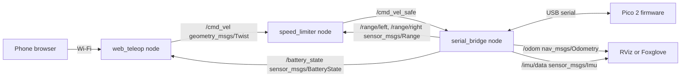

# Day 5: First Robot System Design

*100 Days of Robotics Engineering, Module 1: Robotics Engineering Foundations*

**Time:** about 5 hours
**You will build:** a complete paper design for a small mobile robot: requirements, compute, power, sensors, actuators, communications, mechanics, software architecture and a costed BOM, committed to GitHub as Markdown, CSV and diagrams.
**You should know:** Days 1 to 4. You will reuse the Day 2 architecture, the Day 3 requirements, and the Day 4 datasheet and bench-test habits.

---

## 1. The big idea

Module 1 leads here. A paper design shows, at the cost of a pencil, that your motors are too weak, your battery lasts 20 minutes, or your parts cost twice the budget. Finding those problems after buying parts costs money and weeks.

Robotics teams run design reviews on documents like this before anyone orders hardware. A design in a public repo, with numbers and recorded trade-offs, is strong portfolio evidence. It shows that you can make decisions with numbers rather than follow a kit's instructions.

Today you walk through a reference design, the **desk courier** from Day 3, decision by decision. Then you produce your own, either for the courier or for a robot of your choice.

## 2. The order of decisions

You cannot pick a battery before you know the motors, and you cannot pick motors before you know the mass. The sections below follow this dependency order:

```
 requirements ─▶ mechanics (size, wheel, mass budget)
                    │
                    ▼
               actuators (torque, speed) ─▶ motor driver
                    │
 sensors ◀──────────┤
 compute ◀──────────┤
                    ▼
               power budget ─▶ battery ─▶ regulators, fuse, switch
                    │
                    ▼
       communications ─▶ software architecture ─▶ BOM ─▶ risks ─▶ review
                    ▲                                         │
                    └──────────── iterate if anything fails ──┘
```

Each section follows the same pattern: the requirement it serves, the options, the calculation, the decision, and the limitation.

## 3. Requirements

These are the Day 3 requirements plus three found during design. R7 is a learning goal. Writing it down matters, because it changes decisions.

| ID | Requirement | Specification |
|---|---|---|
| R1 | Carry a light item | Payload 0.5 kg; total mass ≤ 2.0 kg |
| R2 | Make the trip quickly | 5 m in ≤ 30 s; cruise ≥ 0.25 m/s |
| R3 | Do not hit obstacles | Detect ≥ 0.30 m ahead; stop before contact |
| R4 | Last a working day | ≥ 1 h of continuous driving per charge |
| R5 | Phone control | Wi-Fi; command latency ≤ 200 ms |
| R6 | Affordable | Robot parts ≤ $250 USD (tools excluded) |
| R7 | Grow with the course | Run ROS 2 so mapping and navigation can be added in Modules 10 to 12 |
| R8 | Safe around people | Top speed 0.4 m/s; physical power switch; stop within 0.5 s of losing commands |
| R9 | Cope with an office | Climb a 5° ramp or threshold strip at reduced speed |

**Common mistake.** Adding requirements silently during design. R7 to R9 have IDs so a reviewer can challenge them.

## 4. Mechanics

**Intuition.** The body sets every other number. A bigger robot needs bigger motors, a bigger battery and more money.

**Options.** Differential drive (two independently driven wheels, steering by speed difference, plus a passive caster) is simple and turns in place. Four-wheel skid steer gives more traction but wastes power when turning. Mecanum or omni wheels move sideways, but they are expensive and perform poorly on carpet. Differential drive wins for a flat office.

**Decision.** A round, two-deck chassis, 200 mm in diameter. It fits between chair legs and turns in place without its edge sweeping outside its own circle. Two 65 mm drive wheels with 170 mm track width (the distance between the drive wheels), and one ball caster at the front. The lower deck holds the motors, battery, driver and MCU. The upper deck holds the SBC and a payload tray with a raised lip.

**Worked example: mass budget.**

| Item | Mass (kg) |
|---|---|
| Two gearmotors with encoders | 0.20 |
| Two wheels and one caster | 0.11 |
| Battery (four 18650 cells and holder) | 0.20 |
| Frame plates and standoffs | 0.35 |
| SBC with cooler | 0.06 |
| MCU, motor driver, regulator, wiring | 0.11 |
| Sensors | 0.03 |
| Fasteners | 0.06 |
| **Robot total** | **1.12** |
| Payload | 0.50 |
| **Loaded total** | **1.62** |

The design mass is 2.0 kg, which leaves about 23 percent margin for parts that weigh more than expected.

**Worked example: tipping check.** When the robot accelerates, it tends to pitch back away from the caster. It tips if a > g × d / h, where d is the horizontal distance from the center of gravity to the wheel axle and h is the height of the center of gravity. With the battery low, estimate d = 30 mm and h = 80 mm. Then a = 9.81 × 30 / 80 ≈ 3.7 m/s². The robot accelerates at only 0.5 m/s², so the margin is large. A tall payload raises h, which is why the tray has a lip and sits low.

**Limitation.** Paper estimates of the center of gravity can be off by tens of millimeters. Check it on the real robot by balancing it on a pencil.

## 5. Actuators

**Intuition.** Size the motor for the worst moment, not the average one: accelerating up a ramp with a full payload.

**Worked example: torque per wheel.** Use m = 2.0 kg, g = 9.81 m/s², wheel radius r = 0.0325 m, acceleration a = 0.5 m/s², rolling resistance coefficient 0.02 (hard floor), and a 5° ramp (sin 5° ≈ 0.087).

- Acceleration force: 2.0 × 0.5 = 1.00 N
- Rolling resistance: 0.02 × 2.0 × 9.81 = 0.39 N
- Ramp force: 2.0 × 9.81 × 0.087 = 1.71 N
- Total: 3.10 N, shared by 2 wheels = 1.55 N per wheel
- Torque per wheel: 1.55 × 0.0325 = 0.050 N·m
- With a safety factor of 2 (the design is twice as strong as the calculated need): **0.10 N·m per wheel**, about 1.0 kg·cm (1 kg·cm ≈ 0.098 N·m)

**Worked example: speed.** Top speed is 0.4 m/s (R8). The wheel circumference is π × 0.065 ≈ 0.204 m, so the required wheel speed is 0.4 / 0.204 × 60 ≈ 118 rpm.

**Choosing a motor.** A brushed DC motor's speed falls roughly in a straight line as torque rises, from its no-load speed at zero torque to zero at stall torque (the maximum torque it makes when held still at full voltage). Running at no more than about a third of stall torque keeps it efficient and cool.

So the spec is: **stall torque ≥ 0.30 N·m (about 3 kg·cm), and no-load speed of about 200 to 300 rpm at battery voltage.** Check a candidate with 250 rpm no-load and 0.30 N·m stall at the working load of 0.10 N·m:

speed = 250 × (1 − 0.10 / 0.30) ≈ 167 rpm, which is about 0.57 m/s at the wheel.

That is above the 118 rpm needed, so firmware can cap the speed at 0.4 m/s and still keep headroom on the ramp.

Candidates: the JGA25-370 family of 25 mm gearmotors with Hall encoders (sold by many suppliers in 6 V and 12 V versions with many gear ratios), or Pololu's 25D metal gearmotors with encoders, which are better documented and cost more. Read the actual listing's rated voltage, rpm, stall torque and stall current, because they vary widely between gear ratios.

**Motor driver.** The Day 4 stall test estimated about 1.8 A at full voltage for a motor this size. The TB6612FNG's 1.2 A continuous rating is too close. **Decision:** the Cytron MDD3A (two channels, 3 A continuous each), with the TB6612FNG as a cheaper fallback only if bench tests show a stall current under about 1 A.

**Common mistakes.** Taking torque from a seller's headline without the voltage it was measured at. Forgetting the ramp. Using the no-load rpm as the driving speed.

**Limitation.** Rolling resistance on carpet can be several times higher than on hard floors. If the office has thick carpet, rerun the numbers with a higher coefficient.

## 6. Compute

**Options and decision matrix.** Each option scores from 1 (poor) to 5 (best) on each criterion. The score is multiplied by the criterion's weight.

| Criterion (weight) | A: ESP32 only | B: Pico 2 + Raspberry Pi 5 | C: Pico 2 + Jetson Orin Nano |
|---|---|---|---|
| Cost (2) | 5 → 10 | 3 → 6 | 1 → 2 |
| ROS 2 path, R7 (4) | 2 → 8 | 5 → 20 | 5 → 20 |
| Power draw (2) | 5 → 10 | 3 → 6 | 1 → 2 |
| Simplicity (2) | 4 → 8 | 3 → 6 | 2 → 4 |
| **Total** | **36** | **38** | **28** |

**Decision: B.** A Raspberry Pi Pico 2 (RP2350) handles the real-time work: encoders, wheel speed control, the bump switch and the safety stop. A Raspberry Pi 5 with 4 GB runs Ubuntu 24.04 and ROS 2 Jazzy, handles Wi-Fi and the phone interface, and has room for mapping later.

**Honest note.** Drop R7, or halve its weight, and option A wins. The matrix shows which requirement drives the decision. An ESP32 can also run micro-ROS, which is a reasonable middle path to argue for in your own design.

**Limitation.** Two processors mean two codebases and a link between them that can fail. The firmware watchdog in Section 10 exists because of this choice.

## 7. Sensors

| Sensor | Serves | Choice | Interface |
|---|---|---|---|
| Two ToF distance sensors, angled about 20° left and right of forward | R3 | VL53L0X breakouts (up to about 2 m) | I2C, with XSHUT pins to set different addresses (Day 2) |
| Front bump switch | R3, R8 | Lever microswitch behind the front edge | GPIO interrupt |
| Wheel encoders | R2, R7 (odometry) | Built into the gearmotors | GPIO, counted by the MCU |
| 6-axis IMU | R7 (better heading) | LSM6DSOX breakout, or an MPU-6050 module (an older part, often sold as clones) | I2C |
| Battery voltage | R4, R8 | Resistor divider into an ADC pin | ADC |

**Worked example: is the ToF fast enough?** At 0.4 m/s, a sensor that updates at 30 Hz lets the robot move 0.4 / 30 ≈ 13 mm between readings. The stopping distance from Day 3 at 0.4 m/s is v² / (2a) = 0.16 / 1.0 = 0.16 m, plus 0.04 m for 100 ms of reaction time, for 0.20 m in total. Detection at 0.30 m leaves 0.10 m of margin. That is tight, so firmware slows to 0.25 m/s whenever an object is within 0.6 m.

**Limitation.** Two narrow ToF beams can miss a thin chair leg between them. The bump switch is the last line of defense. A LiDAR, such as a Slamtec RPLIDAR A1, would close that gap and enable mapping. It is deferred to a later version to protect the budget.

## 8. Power

**Worked example: power budget.**

| Load | Average (W) | Peak (W) | Notes |
|---|---|---|---|
| Raspberry Pi 5 running ROS 2 | 5.0 | 10.0 | Varies with CPU load; measure later |
| Pico 2, sensors, IMU | 0.5 | 0.8 | |
| Two motors driving | 4.0 | 37.0 | Peak is both motors stalled: 2 × 2.5 A × 7.4 V (a conservative figure) |
| Regulator losses (about 10 percent of 5.5 W) | 0.6 | 1.1 | |
| **Total** | **10.1** | **about 49** | |

**Battery sizing.** R4 needs 1 h at about 10 W, which is 10 Wh. A 1.5× margin for aging, cold and estimate error gives 15 Wh usable. Lithium-ion cells should not be drained to empty, so assume about 80 percent of rated energy is usable: 15 / 0.8 ≈ 19 Wh rated, at minimum.

| Option | Energy | Runtime at 10 W, 80 percent usable | Verdict |
|---|---|---|---|
| 2S1P, 3,000 mAh 18650 cells | 7.2 V × 3.0 Ah = 21.6 Wh | about 1.7 h | Meets R4, thin margin |
| 2S2P, 3,000 mAh 18650 cells | 7.2 V × 6.0 Ah = 43.2 Wh | about 3.5 h | **Chosen.** Room for a LiDAR later |

Buy cells from known manufacturers (Samsung, Molicel, LG, Murata/Sony) through reputable sellers. A cell labeled "9,900 mAh" in the 18650 size is fake, because real 18650 cells top out around 3,500 mAh.

**Regulators.** The Pi 5 is designed for 5 V at up to 5 A. **Decision:** a 5 V, 5 A buck regulator, such as Pololu's D36V50F5 or a similar rated module, feeds the Pi through its GPIO 5 V pins or a USB-C adapter. Feeding through the GPIO pins skips the Pi's input protection, and the Pi 5 limits USB current unless it knows the supply can deliver 5 A. You will handle both details when you build. The Pico 2 is powered from the Pi over USB, which also carries the serial link. The motor driver runs directly from the battery.

**Protection.** A 2S protection board (BMS, battery management system) on the pack. A 7.5 A blade fuse right after the battery, because the realistic peak is about 6.5 A at 7.4 V (37 W of motors plus 11 W of electronics, divided by 7.4 V). A latching power switch rated at least 10 A DC. 18 AWG wire on the battery path.

**Battery monitor.** A full 2S pack reads 8.4 V, above the Pico's 3.3 V ADC limit. A divider with 20 kΩ on top and 10 kΩ on the bottom scales 8.4 V to 2.8 V. Days 6 and 7 explain why the divider works.

**Limitation.** A buck regulator needs its input to stay above its output by a margin. When the pack falls toward 6.0 V (3.0 V per cell), the 5 V rail may sag and reset the Pi. Firmware warns at 6.8 V and shuts down cleanly at 6.4 V.

## 9. Communications

| Link | From → to | Physical | Rate | Content |
|---|---|---|---|---|
| Phone ⇄ Pi | Phone browser to Pi | Wi-Fi | 10 to 20 Hz | Drive commands, status |
| Pi ⇄ Pico | Pi to Pico | USB serial, 115,200 baud | 20 Hz down, 50 Hz up | Day 3 interface agreement |
| Pico ⇄ sensors | Pico to ToF and IMU | I2C at 400 kHz | 30 to 100 Hz | Distance, acceleration, rotation |
| Pico → driver | Pico to MDD3A | PWM and direction pins | about 20 kHz PWM | Motor commands |
| Encoders → Pico | Motors to Pico | GPIO, 3.3 V logic | Continuous | Quadrature pulses |

**Check.** The encoder Hall sensors are often powered at 3.3 to 5 V. Power them at 3.3 V, or confirm that their output is safe for the Pico's 3.3 V pins.

**Latency check for R5.** Office Wi-Fi typically adds tens of milliseconds. ROS 2 processing on the Pi takes a few milliseconds. A 20-character line at 115,200 baud takes about 20 × 10 / 115,200 ≈ 1.7 ms. The firmware loop adds 10 ms. The total is well under 200 ms, but measure it, because busy office Wi-Fi can spike.

## 10. Software architecture

**Firmware on the Pico 2** (C/C++ with the Pico SDK, or the Arduino framework):

| Task | Rate | Purpose |
|---|---|---|
| Encoder counting | Continuous (PIO hardware) | Wheel position and speed |
| Wheel speed PID | 100 Hz | Track left and right target speeds |
| ToF and bump reading | 30 Hz and interrupt | Local obstacle stop, independent of the Pi |
| Command watchdog | Every loop | Stop if no command arrives for 500 ms (R8) |
| Battery monitor | 1 Hz | Warn and shut down (Section 8) |
| Telemetry | 50 Hz | Encoder ticks, ranges, IMU, battery to the Pi |

**ROS 2 Jazzy on the Pi:**



The web page can be served through `rosbridge_suite` or a small custom node. The obstacle stop exists twice on purpose. The `speed_limiter` node slows the robot near obstacles, and the firmware stops it even if the whole Pi has crashed.

**Worked example: a velocity command becomes wheel speeds.** For differential drive with track width b, forward speed v and turn rate ω:

```python
def wheel_speeds(v, omega, track_width=0.17):
    """Return (left, right) wheel speeds in m/s."""
    left = v - omega * track_width / 2
    right = v + omega * track_width / 2
    return left, right

print(wheel_speeds(0.25, 1.0))   # (0.165, 0.335)
```

At 0.25 m/s while turning at 1 rad/s, the left wheel runs at 0.165 m/s and the right wheel at 0.335 m/s. Module 8 derives this properly.

**Limitation.** A custom serial protocol is quick to write and easy to get subtly wrong, with lost bytes or half lines. Add a checksum to each line. In Module 10, compare it with micro-ROS or `ros2_control`.

## 11. Bill of materials and budget

Prices are approximate USD ranges from 2025 to 2026 retail listings. They vary by country, seller and month. The target column is a realistic mid-range choice.

```csv
ref,qty,item,example_part,serves,unit_low_usd,unit_high_usd,target_unit_usd,target_ext_usd,category
U1,1,Single-board computer,Raspberry Pi 5 4 GB,R5 R7,60,85,70,70,robot
U2,1,Active cooler for SBC,Raspberry Pi Active Cooler,R7,5,10,5,5,robot
U3,1,microSD card 32-64 GB A2,SanDisk or Samsung,R7,8,15,10,10,robot
U4,1,Microcontroller board,Raspberry Pi Pico 2,R2 R3 R8,5,8,5,5,robot
U5,1,Dual motor driver 3 A,Cytron MDD3A,R1 R2 R9,8,15,10,10,robot
M1-M2,2,Gearmotor with encoder ~250 rpm,JGA25-370 class or Pololu 25D,R1 R2 R9,12,50,15,30,robot
W1,1,65 mm wheel pair with hubs,match motor shaft,R2,6,15,8,8,robot
W2,1,Ball caster,metal ball caster,R1,3,8,4,4,robot
S1-S2,2,ToF distance sensor breakout,VL53L0X,R3,4,15,6,12,robot
S3,1,6-axis IMU breakout,LSM6DSOX or MPU-6050 module,R7,3,15,5,5,robot
S4,1,Bump microswitch,lever microswitch,R3 R8,2,5,2,2,robot
B1,4,18650 Li-ion cell ~3000 mAh,Samsung Molicel LG or Murata,R4,4,8,6,24,robot
B2,1,2S BMS board and 2S2P holder,generic,R4 R8,5,12,8,8,robot
P1,1,5 V 5 A buck regulator,Pololu D36V50F5 or similar,R7,5,30,10,10,robot
P2,1,Inline blade fuse holder + 7.5 A fuse,generic,R8,3,6,4,4,robot
P3,1,Latching power switch >= 10 A DC,generic,R8,3,10,5,5,robot
F1,1,Chassis plates and standoffs,3D printed or laser-cut acrylic,R1,10,30,15,15,robot
H1,1,Wire 18 and 24 AWG + connectors + heat-shrink,XT30 or JST,all,10,20,12,12,robot
H2,1,M3 screw and standoff kit,generic,all,8,15,10,10,robot
H3,1,Resistors for battery divider,20k and 10k,R4,1,1,1,1,robot
H4,1,USB cable Pi to Pico,USB-A to micro-USB,R7,3,6,4,4,robot
T1,1,Li-ion charger,Nitecore or XTAR cell charger or a 2S balance charger,R4,15,60,25,25,tooling
```

**Does it meet R6?**

- Robot parts, low end: about $196. High end: about $468. Target: **$254**.
- Add 15 percent contingency for shipping, breakage and forgotten parts: 254 × 1.15 ≈ **$292**.
- R6 says $250, so **the design fails R6.**

That is a normal and useful result. The options are: (1) switch to compute option A, which saves about $85 (the Pi, its cooler and the SD card); (2) cut cost elsewhere and accept a thinner margin; or (3) raise R6 to $300, because R7 adds long-term value. Pick one and record it in `design-decisions.md` with the reason. The charger is listed as tooling because you buy it once for many robots.

**Common mistakes.** A BOM with no wires, fasteners, SD card or charger. Prices copied without a date. Parts with no link to the requirement they serve.

## 12. Risks and design review

**Risk register (top five):**

| Risk | Likelihood | Impact | Plan |
|---|---|---|---|
| Motors weaker than the listing claims | Medium | High | Day 4 bench stall test before buying the second motor |
| Pi resets when motors start (brownout) | Medium | High | Separate 5 V buck, bulk capacitor at the driver, firmware acceleration limit |
| ToF misses thin chair legs | High | Medium | Bump switch, slow zone at 0.6 m, LiDAR in v2 |
| Li-ion pack mishandled | Low | Very high | BMS, fuse, proper charger, charging rules from Day 4 |
| BOM over budget | High (already true) | Medium | Decision recorded in Section 11 |

**Review checklist.** Before you call the design done, check:

- [ ] Every requirement maps to at least one design decision and one future test
- [ ] Every calculation shows units and its assumptions
- [ ] The motor driver's continuous rating exceeds the expected running current, and its peak exceeds stall
- [ ] Every logic connection is checked for 3.3 V vs 5 V compatibility
- [ ] The battery is fused, switched and monitored
- [ ] A stop path works even if the SBC crashes
- [ ] The BOM total is compared with the budget, with a recorded decision

A review like this is called a PDR (preliminary design review) at hardware startups, and senior engineers are expected to lead one.

## 13. Hands-on exercises (about 60 minutes)

1. **Carpet rerun (15 min).** Repeat the Section 5 torque calculation with a rolling resistance coefficient of 0.08. Check: rolling force 1.57 N, total 4.28 N, 2.14 N per wheel, torque 0.070 N·m, and 0.14 N·m with the safety factor of 2. That is 47 percent of the 0.30 N·m stall spec. It is under stall, but above the one-third guideline. Decide what you would change: a larger motor, a higher-torque gearbox, or a thinner margin you accept and record.
2. **Runtime with a LiDAR (10 min).** Add a 2.5 W LiDAR to the power budget. Recalculate the 2S2P runtime.
3. **Stopping at top speed (10 min).** If you raise top speed to 0.5 m/s, what detection distance do you need with 0.10 m of margin? Use the Day 3 method.
4. **Matrix sensitivity (10 min).** Change the R7 weight from 4 to 2 in Section 6. Which option wins? Write one sentence on what that means for your choice.
5. **Datasheet check (15 min).** Find a real listing or datasheet for one gearmotor you would buy. Record rated voltage, no-load rpm, stall torque and stall current. Does it meet the Section 5 spec?

## 14. Project: your first robot system design

**Why this project is a paper design:** the outline asks for a design on paper. The evidence of skill is the reasoning: numbers, trade-offs and recorded decisions. Hardware comes later, and this repo becomes the plan you check it against.

**Repo name:** `100-days-robotics-day-05-first-robot-design`

Start from the Day 3 template repo, and reuse and update the Day 2 diagrams.

```
100-days-robotics-day-05-first-robot-design/
├── README.md                     # summary, key numbers, diagram, links
├── docs/
│   ├── requirements.md           # R-table with specs and verification
│   ├── design.md                 # sections 4 to 10 of this lesson, one per heading
│   ├── design-decisions.md       # every decision, date, reason, alternatives
│   └── risks.md                  # risk register and review checklist
├── diagrams/
│   ├── system-block.md           # Mermaid hardware block diagram
│   └── ros2-graph.md             # Mermaid node and topic graph
├── bom/
│   ├── bom.csv                   # format from Section 11
│   └── power-budget.csv
├── calc/
│   └── sizing.py                 # the calculations as a script
└── notebook/
    └── YYYY-MM-DD.md             # design log entries
```

**Starter `calc/sizing.py`** (lets a reviewer rerun your numbers):

```python
import math

m, g, r = 2.0, 9.81, 0.0325          # kg, m/s^2, m
a, crr, slope_deg = 0.5, 0.02, 5.0   # m/s^2, -, degrees
sf = 2.0

force = m * a + crr * m * g + m * g * math.sin(math.radians(slope_deg))
torque_per_wheel = force / 2 * r * sf
rpm_needed = 0.4 / (math.pi * 2 * r) * 60

print(f"Total force: {force:.2f} N")
print(f"Torque per wheel with SF: {torque_per_wheel:.3f} N·m")
print(f"Wheel rpm for 0.4 m/s: {rpm_needed:.0f}")
```

Expected output: about 3.10 N, 0.101 N·m and 118 rpm.

**Steps.**

1. Choose your robot: the desk courier, or your own idea from Day 1 with its own requirements.
2. Write the requirements first. Commit.
3. Work through Sections 4 to 10 in order, one document each, committing after each one.
4. Build the BOM with price ranges, a target column and the requirement each part serves. Total it and compare it with the budget.
5. Write the risk register and run the review checklist on yourself. Fix what fails, or record why you accept it.
6. Fill the README with a one-paragraph summary, a table of key numbers (mass, top speed, runtime, cost) and the block diagram.
7. Tag the result `v1.0-paper-design` and push with tags.

**README checklist.**

- [ ] One-sentence purpose, and the requirement table or a link to it
- [ ] Key numbers table: mass, speed, torque per wheel, runtime, BOM total
- [ ] System block diagram and ROS 2 graph render on GitHub
- [ ] Links to the BOM and the power budget
- [ ] Top three risks and the plan for each
- [ ] The budget decision, stated plainly

**Done when.**

- Every number in the design traces to a calculation with units.
- The BOM has a price range for every line and a source to search for each part.
- A reviewer could order parts from your BOM without asking you a question.
- The design passes your own review checklist, or each failure is explained.

**Evidence to commit:** all Markdown documents, `bom.csv`, `power-budget.csv`, the Mermaid diagrams, the sizing script and its output, at least one notebook entry, and the `v1.0-paper-design` tag.

## 15. Check your understanding

1. Why do you size the motors for accelerating up a ramp, when the robot spends most of its time cruising on a flat floor?
2. The design runs a motor at one third of its stall torque. What goes wrong if you run it at 80 percent of stall instead?
3. Why does the obstacle stop exist in both the firmware and the ROS 2 `speed_limiter` node?
4. The BOM fails R6. Why is that a good outcome for a paper design?
5. Option A wins the decision matrix when R7's weight drops. What does that tell you about how to defend your choice in a review?
6. A reviewer says, "Just use one bigger 5 V regulator for everything, including the motors." What is your reply?
7. Your pack is 2S2P, and one cell is weaker than the others. What happens, and which BOM items help?

**Answers.**

1. The motor must handle the worst case, or the robot stalls on the ramp. Cruising needs far less torque, so a motor sized for the worst case cruises easily.
2. Speed drops sharply, current rises toward stall, the motor heats up and wastes battery, and there is no torque left for disturbances.
3. Defense in depth. The ROS 2 node handles smooth slowdowns, but it depends on the Pi, Wi-Fi and the serial link. The firmware stop works even if all of those fail.
4. The problem is found before any money is spent, and the fix is a recorded decision instead of a surprise.
5. Your choice depends on R7, so defend R7 directly. Explain why ROS 2 matters for this robot's future, or accept option A.
6. Motor current spikes would cause dips and noise on the rail that feeds the Pi and the Pico, risking brownouts. The motors should run from the battery through their own driver, with separate regulated rails for logic.
7. In a 2S2P pack, the weak cell sits in a parallel pair with a healthy cell. The healthy cell feeds current into the weak one, and the pair runs out early. Both cells also age faster. The BMS protects against over-discharge, and matched cells from one batch limit the imbalance.

## 16. Sources

**Read:**
- [Wikipedia: Differential wheeled robot](https://en.wikipedia.org/wiki/Differential_wheeled_robot)
- [Wikipedia: Rolling resistance](https://en.wikipedia.org/wiki/Rolling_resistance)
- [Wikipedia: Odometry](https://en.wikipedia.org/wiki/Odometry)
- [Wikipedia: Factor of safety](https://en.wikipedia.org/wiki/Factor_of_safety)
- [Wikipedia: Decision matrix](https://en.wikipedia.org/wiki/Decision_matrix)
- [Wikipedia: Bill of materials](https://en.wikipedia.org/wiki/Bill_of_materials)
- [Wikipedia: Battery management system](https://en.wikipedia.org/wiki/Battery_management_system)
- [ROS 2 Jazzy documentation](https://docs.ros.org/en/jazzy/): read "Concepts: Nodes" and "Concepts: Topics"
- [Raspberry Pi documentation](https://www.raspberrypi.com/documentation/): the Raspberry Pi 5 power supply section and the Pico 2 overview
- ROBOTIS e-Manual, TurtleBot3 "Specifications" page (search on emanual.robotis.com) for a real reference design to compare against
- Datasheets and product pages to search: "Cytron MDD3A," "Pololu D36V50F5," "VL53L0X datasheet" (st.com), "LSM6DSOX datasheet" (st.com)

**Tutorials:**
- GeeksforGeeks: search "Differential Drive Robot" and "Decision Matrix"
- Pololu: search "Pololu 25D metal gearmotors" for a well-documented example of motor specification tables
- Battery University: search "BU-205 Types of Lithium-ion" and the articles on lithium-ion safety at batteryuniversity.com

**Watch:**
- [Articulated Robotics](https://www.youtube.com/@ArticulatedRobotics): the mobile robot build series, especially the videos on planning and choosing parts
- MIT OpenCourseWare: search ocw.mit.edu for "2.007 Design and Manufacturing I" and look at the robot design lecture material
- [The Construct](https://www.youtube.com/@TheConstruct): search "differential drive robot ROS 2"

**Practice:**
- [Wokwi](https://wokwi.com/): simulate the Pico 2 side of the design, including a virtual distance sensor and PWM outputs, before buying parts

**Note on links:** open each one once. If a page has moved, search its title. Prices are approximate and change often, so check before you buy.

## 17. Tomorrow

Day 6, **Electricity Fundamentals**, starts Module 2: Electronics for Robotics. Today you used watts, volts, amps and watt-hours without explaining them. Tomorrow covers charge, voltage, current, resistance, power and energy, DC and AC, conductors, and what "ground" means, built around `V = IR` and `P = VI`. Every line of today's power budget is a `P = VI` calculation, and the battery divider is `V = IR` in action. Keep the Day 5 repo open. By the end of Module 2, you will be able to check every electrical number in it yourself.
