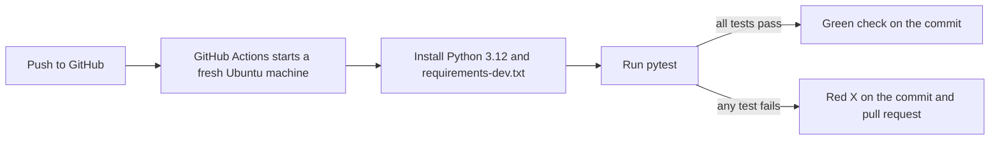

# Day 1: Software Engineering and the SDLC

*100 days of Software Engineering, Module: Foundations*

**Time:** about 3 hours
**Level:** beginner. No programming experience is needed. You will install Python, git and pytest, and run commands in a terminal.

**By the end of this day, you will have:**

- A clear explanation of the six SDLC phases and where your own app idea sits among them
- A requirements plan for a small app: a problem statement and user stories with acceptance criteria
- A GitHub repository for `storycheck`, a small Python tool with pytest tests, a README, and a GitHub Actions workflow that runs the tests on every push

**What you need:**

- Python 3.12 (check with `python --version`; on Windows, tick "Add python.exe to PATH" when installing)
- git 2.40 or newer (check with `git --version`)
- A GitHub account
- pytest 8.3.4 (installed from `requirements-dev.txt` in the project)
- Any code editor, such as VS Code

**Prerequisites:**

- Comfort opening a terminal and moving between folders with `cd`
- No programming experience needed

---

## In this guide you are going to cover the following

- [Introduction](#introduction)
- [Programming and software engineering](#programming-and-software-engineering)
- [The software development life cycle](#the-software-development-life-cycle)
- [Waterfall and iterative models](#waterfall-and-iterative-models)
- [Roles on a software team](#roles-on-a-software-team)
- [Requirements and acceptance criteria](#requirements-and-acceptance-criteria)
- [Version control with git and GitHub](#version-control-with-git-and-github)
- [Automated tests with pytest](#automated-tests-with-pytest)
- [Continuous integration and delivery](#continuous-integration-and-delivery)
- [Engineering tradeoffs](#engineering-tradeoffs)
- [Technical debt](#technical-debt)
- [Product thinking before code](#product-thinking-before-code)
- [Hands-on exercises](#hands-on-exercises)
- [Project: a command-line checker for user stories](#project-a-command-line-checker-for-user-stories)
- [Check your understanding](#check-your-understanding)
- [Sources to read and watch](#sources-to-read-and-watch)
- [Tomorrow](#tomorrow)

---

## Introduction

Programming is writing instructions for a computer. Software engineering is the wider job of deciding which instructions to write, why, in what order, and how to keep them working after the first version ships. Most beginners assume the job is typing code. Working engineers spend much of their time on the rest: understanding users, choosing a readable design, testing changes, releasing them, and fixing them when reality surprises the team.

The software development life cycle (SDLC) is the name for that whole process. Teams use many variants, but the same stages appear in each. A good lead does not start a request with "how do we code this?" They ask what problem is being solved and how the team will know it worked.

[Wikipedia: Software development process](https://en.wikipedia.org/wiki/Software_development_process) describes the main models. Read its introduction today.

---

### Programming and software engineering

A home cook follows a recipe and produces dinner. A restaurant also needs someone to plan the menu, order ingredients, train the cooks, and check every dish before it leaves the kitchen. The recipe is the code. Software engineering is running the restaurant.

A program is a sequence of instructions. Software engineering adds three questions to each one: is it the right instruction, can the next person understand it, and does it keep working when something changes?

Software engineering is the discipline of building and maintaining software systematically, with explicit requirements, recorded design decisions, automated tests, and a repeatable path to release.

Suppose a user asks for "a button that exports my notes." A programmer can write the export in an hour. A software engineer asks which format is needed, what happens with 10,000 notes, and how the export will be tested before it reaches users. The hour of coding is the smallest part of the job.

A common mistake is treating "it works on my laptop" as proof. To spot it, ask "how do you know?" If the answer is "I tried it once," the work is not verified. On GitHub-based teams, every issue and pull request reminds the team that the requirement comes before the code.

### The software development life cycle

A house goes through the same stages whether the builder is careful or not: the owner describes it, an architect draws it, workers build it, an inspector checks it, the family moves in, and someone repairs the roof in year eight. Software follows the same arc, and the arc repeats.

Each phase produces an output the next phase depends on. The phases are not one-time events. Work moves forward, and loops back when a later phase reveals a problem.

The SDLC is the sequence of stages a product passes through, from idea to retirement, with feedback loops between them.

| Stage | Question it answers | Typical output |
|---|---|---|
| Requirements | What problem are we solving, and for whom? | User stories, acceptance criteria |
| Design | How will the parts fit together? | Diagrams, data models, interface definitions |
| Implementation | How do we write it? | Code, commits, pull requests |
| Testing | How do we know it works? | Automated tests, manual checks, bug reports |
| Deployment | How does it reach users? | Release, configuration, rollout plan |
| Maintenance | How does it keep working? | Bug fixes, updates, monitoring |

```
Requirements ──► Design ──► Implementation ──► Testing ──► Deployment ──► Maintenance
     ▲                                                                        │
     └─────────────── feedback from users, tests and monitoring ◄─────────────┘
```

Suppose a tester finds that the notes export drops line breaks. The fix goes back to implementation, which reveals the design assumed one line per note. The design changes, and the requirements gain the criterion "line breaks are preserved." One bug moved work backward through three phases, which is normal.

A common mistake is skipping a tedious phase, usually requirements or testing. The cost moves to maintenance, where it is larger. To spot it, look for a project with no written acceptance criteria and no test that runs before release. Real teams show these phases as board columns in Jira or GitHub Projects.

### Waterfall and iterative models

A wedding cake made from a fixed order is waterfall: you decide everything first and execute the plan. Dinner for friends, tasted and adjusted as you cook, is iterative. Both can work, and they fail in different ways.

Waterfall completes one phase before starting the next, so a wrong requirement found late is expensive. Iterative development delivers small working slices, gets feedback, and adjusts, though it can drift without a clear architecture.

Suppose a feature needs two weeks of building. Under waterfall, the team spends three weeks on requirements, three on design, two on building and two on testing. The first real user sees it in week ten and learns it solves the wrong problem. Under an iterative approach, a one-week slice ships in week two, and the same lesson arrives while it is still cheap.

A common mistake is choosing a model because it is fashionable. Agile is a family of iterative methods, including Scrum and Kanban. To spot a misfit, look for a team that runs sprints but never releases anything, or one that plans a year of detail for a product nobody has tried. Most product teams today use some form of agile.

### Roles on a software team

A film crew has a director, a writer, a camera operator, an editor and a producer. Each owns a question about the final film. A software team works the same way.

| Role | Question it owns | Typical output |
|---|---|---|
| Product manager | What should we build, and why? | Problem statements, priorities |
| Designer | How will the user experience it? | Mockups, user flows |
| Developer | How do we build it so others can change it? | Code, pull requests |
| Tester (QA) | How do we know it works, and where might it break? | Test plans, bug reports |
| Release or DevOps engineer | How does it reach users reliably? | Pipelines, deployment configuration |
| Operations or support | How does it keep working? | Monitoring, incident reports |

A role is a set of responsibilities, not a job title. Small teams combine roles. In this project you will be the product manager, the developer, the tester and the release engineer at once.

A common mistake is assuming testing belongs to someone else, so nobody writes tests. To spot it, look for a repository with no test folder and a comment such as "QA will catch it." On GitHub teams, the author and a reviewer share testing through pull request checks.

### Requirements and acceptance criteria

"Something with cheese" is a wish. "Large, half pepperoni and half mushroom, delivered by 7pm, under $20" is a specification you can check. Software requirements need the same precision.

A requirement says what the software must do. A user story is a common format: "As a ___, I want ___, so that ___." An acceptance criterion is a yes-or-no statement that proves the story is done.

```text
Story: As a student, I want a focus timer, so that I can study in blocks
- The timer starts when I press Start
- After 25 minutes of focus, the timer shows 0 minutes left
```

The second criterion can become a test, because a tester can run it and get pass or fail. "The timer feels responsive" cannot.

A common mistake is writing criteria that describe feelings, such as "the app feels fast." To spot it, ask whether two reviewers could disagree about the result. If they could, rewrite the criterion with a number or an observable action. Product managers usually write stories as GitHub issues or Jira tickets, and testers turn the criteria into test cases.

### Version control with git and GitHub

A video game save point lets you go back when a boss fight goes wrong. Version control does the same for code, with labelled save points you can compare, and several people can work on one project without overwriting each other.

Git stores a project as a chain of commits. A commit is a snapshot of chosen files, with a message, an author, a time, and a link to the previous commit. GitHub hosts git repositories and adds pull requests, issues and Actions.

```bash
git init
git add storycheck.py
git commit -m "Add story parser and criteria check"
git log --oneline
```

The last command prints one line per commit, newest first, such as `9c1a2f3 Add story parser and criteria check`.

A common mistake is committing the `.venv` folder or cache files, so the history fills with files that are not source code. To spot it, run `git status` before each commit and look for folders you did not write. The fix is a `.gitignore` file. Reviewers read pull request diffs, so clean commits with clear messages make review faster.

### Automated tests with pytest

A smoke detector checks the air every few seconds, whether or not you remember to look. Automated tests work the same way: they run the same checks every time.

A test is a function that calls your code with a known input and asserts the output you expect. pytest finds every function whose name starts with `test_`, runs it, and reports failures.

```python
from storycheck import parse

def test_parse_counts_criteria():
    stories = parse("Story: a\n- one\n- two\n")
    assert len(stories[0].criteria) == 2
```

Run `python -m pytest -v` and look for a summary such as `10 passed`. If `parse` drops a criterion, this test fails and names the line.

A common mistake is writing a test that cannot fail, such as one with no `assert`, or one that copies the code under test and compares it with itself. To spot it, break the function on purpose and confirm the test turns red. Most Python projects run pytest, and reviewers usually ask whether new behavior has new tests.

### Continuous integration and delivery

A car factory does not rely on one inspector who checks cars when they feel like it. Every car passes the same checks at the same stations. Continuous integration (CI) applies that idea to code: changes are merged often and checked automatically. Continuous delivery (CD) means a change that passes the checks can be released at any time.

The checks run in a clean environment every time, so "it works on my machine" stops being an excuse. The pipeline in this project looks like this:



If a push breaks `parse` so that it drops the last criterion, pytest exits with a non-zero code, the job fails, and the commit shows a red X. Nobody has to remember to run the tests.

A common mistake is ignoring a red build or making the pipeline optional. To spot it, scan the main branch's history for red marks. Teams often require a passing build before a pull request can merge. GitHub Actions, GitLab CI and Jenkins are the usual tools.

### Engineering tradeoffs

A sports car is fast but carries little. A van carries a lot but is slow to turn. A hybrid saves fuel but costs more to buy. No car wins on every measure, and neither does software.

Every design decision trades one quality for another: speed of delivery against quality of design, flexibility against simplicity, a feature now against maintenance later. A tradeoff is a choice where improving one thing costs you something else.

Suppose your team has two days. Option A stores notes in a single JSON file. It takes two hours, is easy to read, and gets slow above a few thousand notes. Option B uses a database. It takes two days, scales well, and adds a service to run. For a personal app with 200 notes, option A is right. For 200,000 users, option B is.

A common mistake is deciding without writing down what you gave up. To spot it, look for a decision with no sentence beginning "we accepted." Many teams keep short architecture decision records (ADRs), small Markdown files in a `docs/` folder.

### Technical debt

A credit card lets you buy something today and pay later, with interest. Technical debt works the same way. A shortcut saves time now, and every later change that touches it pays interest in extra work.

Technical debt is the extra future cost caused by choosing an easy solution now. A deliberate shortcut for a demo can be sensible, as long as you know you took it and write it down.

A team stores passwords in plain text to ship a prototype a week earlier. The shortcut saves a few hours. Every later login feature must now handle the risk, and one leak exposes every account. The honest version records the shortcut, the reason, and a plan to fix it before real users arrive.

A common mistake is taking on debt silently. To spot it, look for `TODO` comments with no name or date, or "temporary" code more than a year old. Real teams track debt as issues with a label such as `tech-debt` and reserve time for it each cycle.

### Product thinking before code

A good doctor asks questions before writing a prescription. Software is only useful if someone needs it, so product thinking starts with understanding the need.

Before you write code, answer five questions. Who is the user? What problem do they have today? How do they solve it now, and what is painful about that? What is the smallest version that would help? How will you know it worked?

Suppose a student says, "I need a planner." The five questions reveal she misses deadlines because she forgets assignments. The smallest useful version is a reminder list, not a planner with calendar sync that would take months.

A common mistake is building before defining success. To spot it, ask the team to finish this sentence: "We will know this worked when ___." If nobody can, the work has no target. Product managers usually put this answer at the top of an issue.

---

## Hands-on exercises

**Exercise 1: Map an app you use.**

1. Pick a simple app you use daily, such as a notes app or a banking app. Do not look at its code.
2. Write five things it must do, each starting with "A user can." Check: five items, each starting with those words.
3. Draw the main parts you think exist, such as a client, a server and a database. Label each "guess." Check: every part has the word "guess" beside it.
4. List three things you would test first in a clone. Check: each is one action with an expected result.
5. Write how users get updates: an app store, a web page, or both. Check: your answer names a channel.
6. If the company publishes an engineering blog, compare your guesses with it. Check: you have one thing right and one thing wrong.

**Exercise 2: Write three user stories with criteria.**

1. Choose an app idea. A habit tracker, a bookmark manager or a recipe-to-shopping-list tool all work.
2. Write three stories in the form "As a ___, I want ___, so that ___." Check: all three parts appear in each.
3. Under each story, write two acceptance criteria. Check: each one can be answered yes or no.
4. Ask whether two people would always agree on pass or fail for each criterion. Rewrite any that fail this test. Check: you rewrote at least one, or can say why none needed it.

**Exercise 3: Record one piece of debt.**

1. Imagine a prototype of your app that skips one feature to ship faster, such as password reset or data export.
2. Write three sentences: the shortcut, the reason, and the fix. Check: all three exist.
3. Write the risk to a user if the shortcut stays forever. Check: it names a concrete consequence.

---

## Project: a command-line checker for user stories

Your project is `storycheck`, a small Python command-line tool. It reads a text file of user stories and acceptance criteria, and exits with code 1 if any story has fewer than two criteria. It uses only the standard library. You will use git and GitHub for history, pytest for tests, and GitHub Actions to run the tests on every push.

### Repository layout

```
100-days-software-day-01-software-engineering-and-the-sdlc/
├── .github/
│   └── workflows/
│       └── tests.yml          # GitHub Actions: runs pytest on every push
├── .gitignore                 # keeps .venv and cache folders out of git
├── README.md                  # problem, usage, file format, roadmap
├── requirements-dev.txt       # pytest==8.3.4
├── storycheck.py              # the parser and the checker
├── stories.txt                # example requirements file
└── tests/
    └── test_storycheck.py     # pytest tests
```

### Step 1: install the tools and create the repository

1. Run `python --version`. It must print `Python 3.12.x`. If not, install Python 3.12 from python.org.
2. Run `git --version`. It must print 2.40 or newer.
3. On github.com, click New repository. Name it `100-days-software-day-01-software-engineering-and-the-sdlc`, set it to public, and tick no "Add a file" options.
4. Clone it and enter the folder:

```bash
git clone https://github.com/<your-username>/100-days-software-day-01-software-engineering-and-the-sdlc.git
cd 100-days-software-day-01-software-engineering-and-the-sdlc
```

5. Create and activate a virtual environment, which keeps this project's pytest separate from the rest of your computer:

```bash
python -m venv .venv
source .venv/bin/activate        # macOS or Linux
.venv\Scripts\Activate.ps1       # Windows PowerShell
```

Your prompt should now start with `(.venv)`.

### Step 2: add the ignore file and the dependency list

Create `.gitignore`:

```text
.venv/
__pycache__/
.pytest_cache/
```

Create `requirements-dev.txt`:

```text
pytest==8.3.4
```

Run `python -m pip install -r requirements-dev.txt`, then commit:

```bash
git add .gitignore requirements-dev.txt
git commit -m "Add gitignore and dev requirements"
git push -u origin main
```

Run `git status`. It should report nothing to commit, and `.venv` should not appear.

### Step 3: write the parser and the checker

Create `storycheck.py`:

```python
"""storycheck: check that every user story has enough acceptance criteria."""

import sys
from dataclasses import dataclass, field

MIN_CRITERIA = 2


@dataclass
class Story:
    title: str
    criteria: list[str] = field(default_factory=list)


def parse(text: str) -> list[Story]:
    """Read lines starting with 'Story:' as titles and '- ' lines as criteria."""
    stories: list[Story] = []
    for raw in text.splitlines():
        line = raw.strip()
        if not line or line.startswith("#"):
            continue
        if line.lower().startswith("story:"):
            stories.append(Story(title=line[len("story:"):].strip()))
        elif line.startswith("- "):
            if not stories:
                raise ValueError(f"criterion before any story: {line!r}")
            stories[-1].criteria.append(line[2:].strip())
        else:
            raise ValueError(f"unrecognized line: {line!r}")
    return stories


def find_problems(stories: list[Story], minimum: int = MIN_CRITERIA) -> list[str]:
    """Describe each story that has fewer than the minimum number of criteria."""
    return [
        f"'{s.title}' needs at least {minimum} acceptance criteria, found {len(s.criteria)}"
        for s in stories
        if len(s.criteria) < minimum
    ]


def main(argv: list[str]) -> int:
    """Return 0 if every story passes, 1 if any fails, 2 for a usage error."""
    if len(argv) != 2:
        print("usage: python storycheck.py <stories-file>", file=sys.stderr)
        return 2
    with open(argv[1], encoding="utf-8") as handle:
        try:
            stories = parse(handle.read())
        except ValueError as err:
            print(f"error: {err}", file=sys.stderr)
            return 2
    problems = find_problems(stories)
    for problem in problems:
        print(problem)
    print(f"{len(stories)} stories checked, {len(problems)} problem(s)")
    return 1 if problems else 0


if __name__ == "__main__":
    sys.exit(main(sys.argv))
```

Run `python storycheck.py` with no arguments. It should print the usage message and exit with code 2. Then commit:

```bash
git add storycheck.py
git commit -m "Add story parser and criteria check"
git push
```

### Step 4: write the tests

Create `tests/test_storycheck.py`:

```python
import pytest

from storycheck import find_problems, main, parse

SAMPLE = """\
# focus timer requirements
Story: As a student, I want a focus timer, so that I can study in blocks
- The timer starts when I press Start
- The timer shows minutes left

Story: As a student, I want a break reminder, so that I rest
- A reminder appears when a focus block ends
"""


def test_parse_reads_titles_and_criteria():
    stories = parse(SAMPLE)
    assert [s.title for s in stories] == [
        "As a student, I want a focus timer, so that I can study in blocks",
        "As a student, I want a break reminder, so that I rest",
    ]
    assert stories[0].criteria == [
        "The timer starts when I press Start",
        "The timer shows minutes left",
    ]
    assert stories[1].criteria == ["A reminder appears when a focus block ends"]


def test_parse_skips_blank_lines_and_comments():
    stories = parse("\n# a note\nStory: one\n- a\n- b\n\n")
    assert len(stories) == 1
    assert len(stories[0].criteria) == 2


def test_criterion_before_any_story_is_an_error():
    with pytest.raises(ValueError):
        parse("- orphan criterion\n")


def test_unrecognized_line_is_an_error():
    with pytest.raises(ValueError):
        parse("Stroy: a typo\n")


def test_find_problems_flags_stories_below_minimum():
    problems = find_problems(parse(SAMPLE))
    assert len(problems) == 1
    assert "break reminder" in problems[0]
    assert "found 1" in problems[0]


def test_find_problems_is_empty_when_all_pass():
    assert find_problems(parse("Story: a\n- x\n- y\n")) == []


def test_main_exit_codes(tmp_path, capsys):
    good = tmp_path / "good.txt"
    good.write_text("Story: a\n- x\n- y\n", encoding="utf-8")
    bad = tmp_path / "bad.txt"
    bad.write_text("Story: a\n- x\n", encoding="utf-8")

    assert main(["storycheck.py", str(good)]) == 0
    assert "0 problem(s)" in capsys.readouterr().out
    assert main(["storycheck.py", str(bad)]) == 1
    assert "1 problem(s)" in capsys.readouterr().out
    assert main(["storycheck.py"]) == 2
```

Run `python -m pytest -v`. Use `python -m pytest` rather than `pytest`, so the project folder is on the import path. Every test should show `PASSED`. Then commit:

```bash
git add tests/test_storycheck.py
git commit -m "Add pytest tests for parser and checker"
git push
```

### Step 5: add the stories file and the README

Create `stories.txt`:

```text
# Focus timer: sample requirements
Story: As a student, I want a focus timer, so that I can study in blocks
- The timer starts when I press Start
- The timer shows minutes left and updates every second

Story: As a student, I want a break reminder, so that I rest between blocks
- A reminder appears when a focus block ends
- The reminder can be dismissed with one key press

Story: As a student, I want to see past sessions, so that I can track my study time
- The list shows the date and length of each session
- The list is sorted with the newest session first
```

Run `python storycheck.py stories.txt`. It should print `3 stories checked, 0 problem(s)`. Check the exit code with `echo $?` in bash or `echo $LASTEXITCODE` in PowerShell. It must be `0`.

Create `README.md`. It must contain:

- The problem in two sentences that a non-programmer can understand
- How to run it: install the requirements, run `python storycheck.py stories.txt`, and run `python -m pytest`
- The file format, with one short example
- The exit codes: 0 for pass, 1 for problems found, 2 for a usage error
- A roadmap with three items, such as "support Markdown headings"

Commit both files:

```bash
git add stories.txt README.md
git commit -m "Add sample stories file and README"
git push
```

### Step 6: add the GitHub Actions workflow

Create `.github/workflows/tests.yml`:

```yaml
name: tests

on:
  push:
  pull_request:

jobs:
  test:
    runs-on: ubuntu-latest
    steps:
      - uses: actions/checkout@v4
      - uses: actions/setup-python@v5
        with:
          python-version: "3.12"
      - run: python -m pip install -r requirements-dev.txt
      - run: python -m pytest -v
```

Commit and push:

```bash
git add .github/workflows/tests.yml
git commit -m "Add GitHub Actions workflow that runs the tests"
git push
```

Open the Actions tab on your repository. The newest run should show a green check. Open it and confirm the pytest step lists every test as passed.

Optional: run `git switch -c break-test`, add `assert False` to one test, push the branch, and watch the run turn red. Then delete the branch. That is the failure path CI exists to catch.

### Done when

- The repository exists on GitHub with at least five commits: the ignore file, the parser, the tests, the stories file with the README, and the workflow.
- `python -m pytest` passes locally, and the latest commit on `main` shows a green check in the Actions tab.
- `python storycheck.py stories.txt` prints `3 stories checked, 0 problem(s)` and exits with code 0.
- The README contains all five items from Step 5.
- Each commit message is short, in the present tense, and describes one change.

---

## Check your understanding

1. What is the difference between programming and software engineering?
2. Why does a bug found in testing often send work back to design or requirements, not only to implementation?
3. Why does waterfall struggle when requirements change, and why does iterative development handle the same change better?
4. Why is "the timer feels responsive" a weak acceptance criterion, while "after 25 minutes of focus, the timer shows 0 minutes left" is strong?
5. What does the GitHub Actions workflow in this project protect against, and what does it not check?
6. Give one example of technical debt that was a sensible decision, and say what made it sensible.

**Answers (check after you try):**

1. Programming is writing instructions. Software engineering also covers requirements, design, testing, release and maintenance, and the tradeoffs among them.
2. Each phase produces the input for the next. A bug can reveal a wrong assumption made earlier, so the fix may need a new design or new requirements.
3. Waterfall finishes each phase before the next starts, so a change discovered late must pass through locked earlier phases. Iterative development releases small slices, so a changed requirement is caught within one cycle.
4. The first cannot be checked, because nobody can agree on what "feels responsive" means. The second names a number and an action, so a tester gets a clear pass or fail.
5. It protects against changes that break the tests, on every push, in a clean environment. It does not check whether the requirements are right, whether the stories are good, or whether the code is secure or fast.
6. A deliberate shortcut in a demo prototype, recorded in the README as a known gap with a plan to fix it. The demo was the goal and the cost of the shortcut was known and bounded.

---

## Sources to read and watch

**Read:**
- [Wikipedia: Software development process](https://en.wikipedia.org/wiki/Software_development_process)
- [Wikipedia: Waterfall model](https://en.wikipedia.org/wiki/Waterfall_model)
- [Wikipedia: Agile software development](https://en.wikipedia.org/wiki/Agile_software_development)
- [Wikipedia: Technical debt](https://en.wikipedia.org/wiki/Technical_debt)
- [Wikipedia: Continuous integration](https://en.wikipedia.org/wiki/Continuous_integration)
- [Wikipedia: Git](https://en.wikipedia.org/wiki/Git)
- [Pro Git: About Version Control](https://git-scm.com/book/en/v2/Getting-Started-About-Version-Control): read this first section today
- [Git documentation](https://git-scm.com/doc): the official reference, for command options
- [GitHub Docs: GitHub Actions](https://docs.github.com/en/actions): the overview and workflow syntax

**Tutorials:**
- [GeeksforGeeks: Software Development Life Cycle (SDLC)](https://www.geeksforgeeks.org/software-engineering-sdlc-software-development-life-cycle/)
- Real Python: search "pytest" on realpython.com and read the getting-started article.
- GitHub Docs: search "Hello World" on docs.github.com for the official first-repository walkthrough.

**Watch:**
- [CS50's Introduction to Computer Science](https://cs50.harvard.edu/): the first lecture, for the overall shape of programming.
- [freeCodeCamp.org](https://www.youtube.com/@freecodecamp): search "software development life cycle" and watch one introduction.
- [Computerphile](https://www.youtube.com/@Computerphile): search "software engineering" for a short explainer.

**Practice:**
- [Learn Git Branching](https://learngitbranching.js.org/): the first two levels cover commits and branches, which you will use in the project.
- [pytest documentation](https://docs.pytest.org/en/stable/): read the assertions page after your first tests run.

**Note on links:** open each one once. If a page has moved, search its title; the content is what matters.

---

## Tomorrow

Day 2, **How Computers Execute Programs**, explains what happens between the code you write and the result on screen: the CPU, memory, compilation and interpretation. Bring your `storycheck` repository. You will trace what Python does when `parse` reads one line of `stories.txt`, and compare that with the app idea you wrote about today.

**Next:** [Day 2: How Computers Execute Programs](Software-Day-02-How-Computers-Execute-Programs.md)
